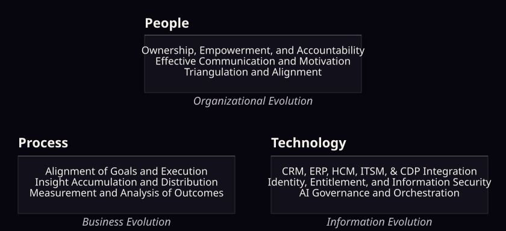

# ETM Projects

**Evolutionary Thinking Machines — Transformation with and Beyond AI.**

> Don't add evolving AI to a non-evolving organization.

ETM helps organizations deliver AI transformation across people, process and technology: business transformation strategy, education, training, coaching, AI automation and AI integration.

## ETM Sponsored Projects

Our open-source projects work with all major enterprise-grade AI systems. Support and maintenance services are available to our enterprise customers.

| Project | What it does | In this repo | On the website |
| --- | --- | --- | --- |
| ETM Muninn™ | Your company's accumulated insights, practices, decision guidelines, and policies live in a memory system you own and control, not inside any one AI vendor. | [projects/muninn](projects/muninn/) · [built-in entity types](projects/muninn/entity-types/) | [/products/muninn](https://www.etmpartnersllc.com/products/muninn) |
| ETM Huginn™ | Deeper reasoning across many sources before any recommendation reaches you. | [projects/huginn](projects/huginn/) | [/products/huginn](https://www.etmpartnersllc.com/products/huginn) |
| ETM Pleiades™ | Switch or add AI systems anytime and bring your agents, workflows, and knowledge with you. | [projects/pleiades](projects/pleiades/) | [/products/pleiades](https://www.etmpartnersllc.com/products/pleiades) |
| ETM Concordia™ | Keeps your people and your AI systems aligned on the same goals, plans, and decisions. | [projects/concordia](projects/concordia/) | [/products/concordia](https://www.etmpartnersllc.com/products/concordia) |
| ETM Chiron™ | Test each new AI system before you trust it, so changes don't break what works. | [projects/chiron](projects/chiron/) | [/products/chiron](https://www.etmpartnersllc.com/products/chiron) |
| ETM Delos™ | Links outcomes to their causes, so every result teaches your organization how to improve. | [projects/delos](projects/delos/) | [/products/delos](https://www.etmpartnersllc.com/products/delos) |

## Talk to ETM

Visit [etmpartnersllc.com](https://www.etmpartnersllc.com/), [Schedule a Discussion](https://calendly.com/joe-etmpartners/30min), or write to joe@etmpartnersllc.com.

ETM, Evolutionary Thinking Machines, ETM Muninn, ETM Huginn, ETM Concordia, ETM Delos, ETM Chiron, and ETM Pleiades are trademarks of Evolutionary Thinking Machines. All other trademarks are the property of their respective owners.
