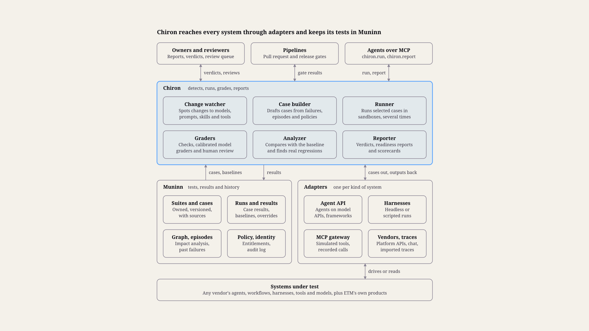
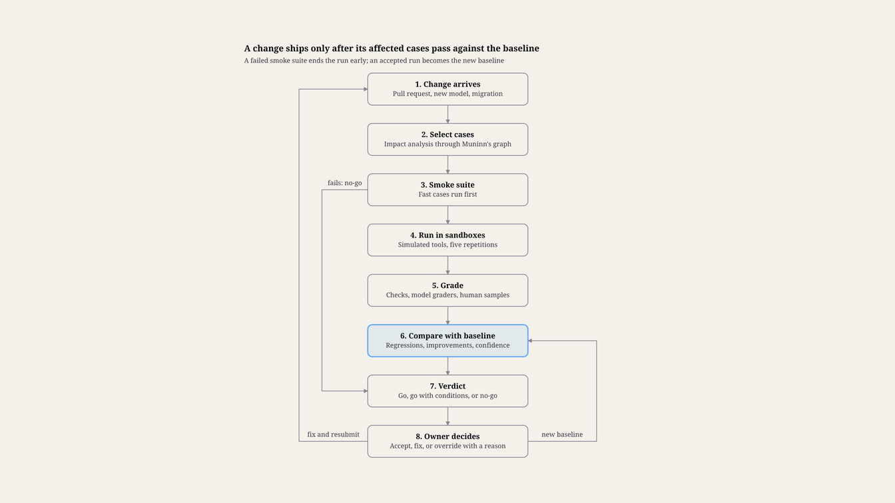

> Customer-facing copy of <https://www.etmpartnersllc.com/products/chiron>, captured 28 October 2026. The live website is the reference version.

# ETM Chiron™: Regression Testing and Evaluation

## Summary and principles

Chiron tells a company what an AI change will break before the company trusts it. It keeps versioned test suites built from the company's own work and knowledge, runs them in a sandbox against every agent, model, prompt, skill and tool change, compares the results with the last trusted baseline, and gives the change's owner a verdict with the evidence behind it.

Chiron architecture · 6 services, adapters, Muninn

### What Chiron does

Keeps the company's tests. Suites of test cases live in Muninn, each case with an owner, a source and a review date.

Catches changes. A new model version, an edited prompt or skill, a new tool, a harness upgrade or a migration triggers the suites the change could affect.

Runs and grades safely. Cases run in sandboxes with simulated tools and test data, several times each, and are graded by deterministic checks, calibrated model graders and sampled human review.

Gives a verdict. The owner gets go, go with conditions, or no-go, with the regressions, improvements and cost and latency changes behind it.

### Design principles

Test against the company's own work. Generic benchmarks say little about a company's tasks, so Chiron's suites come from its policies, procedures, past work and past failures.

Every failure becomes a test. An incident, a guardrail breach or a dismissed brief is turned into a regression case, so the failure cannot quietly return.

Compare with a baseline, not only a threshold. A change is judged first by what it does to results that passed before.

Treat AI output as variable. Each case runs several times, and results carry sample sizes and confidence, so noise is not mistaken for a regression.

Graders are tested too. Model graders are calibrated against human labels and re-baselined whenever they change.

Nothing touches production. Tests run against simulated tools and test data unless an owner approves a staging connection.

Owners decide. Chiron recommends a verdict and the change's owner decides; overriding a no-go needs a recorded reason.

Built on Muninn. Suites, runs and results are Muninn records, so they inherit its security, history, entitlements and portability.

## Architecture

Chiron is a set of services on top of Muninn, plus adapters that reach the systems it tests. Muninn holds the suites, the cases and every result; Chiron detects changes, selects and builds cases, runs them in sandboxes, grades them, compares them with baselines and reports.

A run starts when Chiron sees a change: a Muninn ledger event for an agent configuration, skill or policy, a pull request in the client's repository, a new model version from a vendor, a Pleiades migration, or a schedule. Chiron runs the selected cases through an adapter for each system under test and writes an EVAL-RUN record with every case result. The verdict goes to the change's owner and, when the change is in a pipeline, back to that pipeline as a pass or fail gate.

Chiron keeps its tests and results in Muninn and reaches each system under test, from any vendor, through an adapter.

### Interfaces

Pipeline gate: a check that a pull request or release waits on, with the readiness report linked.

Workspace for owners: suites, cases, runs, review queues and readiness reports, with notifications to Slack, Teams and email.

MCP tools for agents: chiron.run, chiron.report, chiron.add_case and chiron.coverage (see Results for decision-makers).

Adapters for the systems under test (see Coverage of other AI systems).

### Deployment

Chiron deploys next to the client's Muninn, in the client's cloud or hosted by ETM. Sandboxes run in the client's environment, so test data stays there, and model graders call models through the same model port as Concordia and Huginn.

## What Chiron tests

Chiron tests anything whose change can alter how an agent behaves. Each target is a system under test: an agent, an agentic workflow, or one of the parts that shape them.

### Systems under test

System under test| Built-in type| Changes that trigger tests  
---|---|---  
Agent| AI-AGENT| New instructions, roles, tools or model  
Agentic workflow| AGENTIC-WORKFLOW| A new step, hand-off or tool in the flow  
Skill or prompt| SKILL, PROMPT-TEMPLATE, AGENT-GUIDANCE| Any edit  
Model| AI-MODEL| A new model or version, including updates behind a model alias  
Tool or MCP server| AGENT-TOOL| A new version or a changed schema  
Harness| HARNESS| An upgrade or a configuration change  
Company knowledge and intent| Muninn records, Concordia intent| A superseded policy, principle or procedure that an agent depends on  
ETM sponsored projects| Muninn recall, Concordia checks, Huginn deliberation| A new release of the project  
  
### Kinds of checks

Check kind| Question it answers| Example  
---|---|---  
Task success| Does the agent complete the task correctly?| Drafts a renewal quote with the right price and terms  
Tool use| Does it call the right tools with valid arguments, in a sensible order?| Looks up the account before quoting  
Knowledge| Does it answer the company's competency questions correctly?| "Who may approve a 25% discount for this account?"  
Guardrails| Does it stay within policies, principles and decision rights?| Routes a discount above its authority for approval  
Safety and security| Does it resist injection and avoid leaking data?| Ignores instructions planted in an email it summarizes  
Standards| Does its output follow the company's standards?| Uses approved positioning and makes no "only" or "first" claims  
Robustness| Does it behave the same on rephrased or noisy input?| Gives the same answer when the request has typos  
Cost and latency| Does it stay within its budget and time limits?| Tokens, tool calls and seconds per task  
Workflow outcome| Does a whole workflow reach the right end state?| A lead qualified, handed off and logged with no lost context  
  
### What results are judged against

Each check compares behavior with an expectation the company owns: an expected answer or end state, a rubric, a policy, or the system's own last trusted behavior. Every expectation links to the Muninn record it comes from, such as the policy behind a guardrail case, so when that record is superseded Chiron flags the cases built on it for review.

## Suites and cases

A test case is an input, a setup and an expectation, with a way to grade the result; a suite is a versioned set of cases for one system or domain. Both are Muninn records of the built-in types TEST-SUITE, TEST-CASE and COMPETENCY-QUESTION, and every run is an EVAL-RUN.

### Where cases come from

Source| How cases are made| Reviewed by  
---|---|---  
Owners| Written from templates for task, guardrail and workflow cases| The suite owner  
Company knowledge| Generated from Muninn: policies and decision rights become guardrail cases, procedures and skills become task cases, facts become competency questions| The owner of the source record  
Past work| Agent episodes that ended well become golden cases, with their tool calls and end state| The workflow owner  
Failures| Incidents, Concordia guardrail breaches, user complaints and dismissed Huginn briefs become regression cases| The owner of the system that failed  
ETM library| Generic suites for injection, data leakage, tool misuse and robustness| ETM, then the client  
Variants| Rephrasings, typos, reordered inputs and edge values made from existing cases| Sampled by the suite owner  
  
### The case record

Input and setup: the request, the seed data and the simulated tool responses.

Expectation: an answer, an end state, a rubric, or "matches the baseline".

Grader: how the result is judged (see Grading).

Severity: blocking or warning, with a weight.

Tags: the system under test, the domain and the check kind.

Source: a derivedFrom link to the record or episode the case came from.

Owner, review date and status: draft, active, quarantined or retired.

Holdout flag: whether the case is hidden from the people and agents tuning the system.

### Who maintains them

Each suite has an owner, usually the owner of the agent or workflow it tests. Chiron does the routine upkeep: it proposes cases from failures and good episodes, flags cases whose source record was superseded, and quarantines flaky cases until someone fixes them. It retires a case that has passed its review date only after asking the owner.

Generated cases start as drafts and run only after their reviewer approves them, the same rule Muninn applies to imported Normative records.

### Holdout cases

A fixed share of each suite, 20%, is held out: it runs in every regression, but its contents are hidden from the people and agents tuning the system under test. A system that improves on visible cases but not on holdout cases is being fitted to the tests, and the report says so.

## Running evaluations

Every run follows the same path: a change arrives, Chiron selects the cases it could affect, runs them in a sandbox several times each, grades them, and compares the results with the last trusted baseline.

Evaluation run · 8 steps, 3 branches

Only the owner can accept a run as the new baseline; a fix starts a new run from the top.

### Triggers and cadence

Trigger| What runs| Timing  
---|---|---  
A pull request or edit to a prompt, skill, agent configuration or tool| The smoke suite, then the cases tagged for the changed parts| Before merge  
A release of an agent, workflow or ETM sponsored project| The full regression suite for that system| Before release  
A new model version or a harness upgrade| Every suite for the systems that use it| Before the switch  
A Pleiades migration| Parity suites on the old and the new system| Before cutover  
A superseded policy, principle or procedure| The cases derived from it, against the agents bound to it| Same day  
Schedule| Full suites, to catch drift behind model aliases and in data| Nightly or weekly  
  
### Selecting cases

Chiron selects cases by impact: it follows the change through Muninn's graph to the agents, workflows and skills that use it, and runs the cases tagged for those. The smoke suite runs first and ends the run early if it fails.

### Sandboxes

Cases run against simulated tools that return recorded or scripted responses, and against a test copy of the company built from synthetic data, such as the seeded test company Concordia uses. Calls to outside services are recorded once and replayed, so runs repeat exactly. A case that needs a real system runs only against a staging connection its owner approved.

### Repetition and baselines

Each case runs several times, five for gating runs, because the same input can produce different outputs. A case passes reliably only when it passes every time, and reports show both the average pass rate and that strict rate.

The baseline is the last run the owner accepted. A regression is a case that passed reliably on the baseline and now fails, or a drop in a suite's pass rate larger than its measured noise. Each suite's change is reported with a confidence interval from a paired comparison on the same cases.

## Grading

Chiron grades each case with the cheapest method that judges it reliably: deterministic checks first, model graders where judgment is needed, and people where neither is trusted yet.

Grader| Judges| Examples  
---|---|---  
Deterministic| Facts and structure| An expected value is present, output is valid against a schema, the required tool was called with the right arguments, the sandbox end state matches  
Model grader| Quality against a rubric| Tone meets the brand standard, the reply answers the customer's question, the reasoning cites the right policy  
Pairwise| Whether the new output is better or worse than the baseline's| Two quote emails compared side by side, in shuffled order  
Human review| Cases with no trusted automatic grader, and samples of the rest| A sales lead checks sampled outreach drafts from each run  
  
### Calibrating model graders

Each model grader is a versioned rubric plus a model. Before it can gate a release, it is checked against human-labeled examples for its suite, and its agreement with those labels is reported with every run. The bar is agreement at least as high as two human reviewers reach with each other on the same examples.

A grader uses a different model family from the system it grades where possible, because models tend to favor their own outputs. Changing a grader's model or rubric re-runs its calibration and starts a new baseline, so a grader change never shows up as a regression in the system under test.

### Human review

Human review is a queue in the workspace. Reviewers see the case, the output and the rubric, but not which system or version produced the output. Their labels feed grader calibration, and a case where they disagree with a model grader goes to the suite owner.

### Scoring a suite

suite score = (sum of w_i × r_i) / (sum of w_i)

Here w_i is case i's weight and r_i is its pass rate over the repeated runs. A suite passes when its score meets its threshold and no blocking case has regressed.

## Results for decision-makers

A decision-maker gets a verdict first and the evidence second. Every gated change produces a readiness report, every system under test has a scorecard, and PE operating partners see one line per portfolio company.

### The verdict

Verdict| Meaning  
---|---  
Go| No blocking case regressed, and every suite meets its threshold  
Go with conditions| No blocking regressions, but a warning-level drop, a cost or latency increase, or a suite with too few runs to judge; the conditions are listed  
No-go| A blocking case regressed, or a suite fell below its threshold  
  
The owner decides. Accepting a run makes it the new baseline. Overriding a no-go needs a recorded reason, written as a DECISION through Concordia, and the overridden failures stay visible on the scorecard until they are fixed.

### The readiness report

Part| What it shows  
---|---  
Verdict and reason| One line, with the change, its owner and the systems affected  
Regressions| Cases that used to pass and now fail, worst first, with the output and the grader's reason  
Improvements| Cases that used to fail and now pass  
Suite results| Each suite's score against its baseline and threshold, with a confidence interval  
Cost and latency| The change per task in tokens, tool calls and time  
Coverage| Which parts of the change had cases, and which had none  
Holdout check| Whether holdout results moved with the visible ones  
Grader health| Each model grader's agreement with its human labels  
  
### Scorecards

Each system under test has a scorecard: current suite scores, the trend over recent runs, open regressions and overrides, and the date of its last full run. A system with no full run in its required interval shows as unverified, not as passing.

### The portfolio view

PE operating partners see one line per portfolio company: how many of its AI systems are verified, open regressions by severity, and changes shipped with overrides. As with Concordia, each company publishes aggregate results only, unless it chooses to share details.

### MCP tools

Tool| Purpose  
---|---  
chiron.run| Starts a run for a change or a system; returns a run id  
chiron.report| Returns the readiness report and verdict for a run  
chiron.add_case| Proposes a case from an episode, a failure or a description, as a draft for its owner  
chiron.coverage| Shows which cases cover a system, a skill or a Muninn record  
  
## Coverage of other AI systems

Chiron tests AI systems from any vendor, not only ETM's. It reaches each one through an adapter, chosen by how much control the system allows.

Adapter| Reaches| How it works| What it can check  
---|---|---|---  
Agent API| Agents and workflows built on model APIs or agent frameworks| Calls the agent's entry point with the case input and simulated tools| Everything listed under What Chiron tests  
Harness| Coding and work assistants that offer a headless or scripted mode| Runs the harness non-interactively in a sandbox workspace with the case's files, instructions and MCP servers| Task success, tool use, guardrails, standards  
MCP gateway| Any agent that reaches tools through the gateway Muninn deploys| Points the agent's tool traffic at simulated MCP servers and records every call| Tool use, guardrails, safety  
Vendor platform| Agents built inside SaaS agent platforms| Uses the platform's own test or conversation API, where it offers one| Task success, standards, knowledge  
Chat endpoint| Assistants available only as a chat interface or API| Sends the case as a conversation and grades the replies| Knowledge, standards, safety  
Trace import| Systems Chiron cannot drive| Grades logged runs imported as OpenTelemetry traces or harness logs| Tool use, outcomes, cost and latency, after the fact  
  
### Systems covered

The first adapters follow the order of Muninn's delivery profiles (see ETM Muninn): Claude Code and the Claude apps, then Codex and Cursor, then Gemini CLI and GitHub Copilot where they offer a scripted mode, and agents built on the major model APIs. A chat endpoint adapter tests assistants that have no API, where the vendor's terms allow it. Vendor platforms are added as needed. Each adapter is a small, versioned connector with its own conformance tests, so clients and partners can write their own.

### Systems that change without notice

For a system Chiron cannot pin to a version, it runs a scheduled canary suite and reports behavior changes as they appear. A vendor update is caught even when nobody announced it.

### Comparing systems

The same suites can run on several candidate systems to give a like-for-like comparison, for example two models for one agent or two vendors for one workflow. Huginn can use that comparison as evidence when a company chooses between them.

## Trust, safety and governance

Chiron holds some of a company's most sensitive material, including real failures and the data around them, and its verdicts gate releases. Its safeguards protect that material and keep the verdicts honest.

### Test data

Cases built from real episodes or incidents are scrubbed before they become test data: personal data and customer identifiers are replaced with synthetic values, and secrets never enter a case. A case keeps the audience of its source record, so only people who could see the original incident can see the case built from it.

### Sandboxes and side effects

Systems under test run with simulated tools and no production credentials. Any outbound call that was not recorded for replay is blocked and reported as a test failure, so a test can never send an email, move money or change a record by accident.

### Honest verdicts

Holdout cases expose systems tuned to the visible tests (see Suites and cases).

Graders are calibrated, versioned and kept separate from the systems they grade (see Grading).

A suite's threshold or a case's severity changes only through its owner, with the change logged, so a gate cannot be loosened quietly to let a release through.

Overrides are recorded as decisions and stay on the scorecard until fixed.

### Adversarial suites

ETM's library includes prompt-injection, data-leakage and tool-misuse suites, refreshed as new attack patterns appear. They run against every agent that reads outside content or holds tools that can act.

### Reproducibility and audit

Every run pins the versions of the system under test, its model, the cases, the graders and the recorded tool responses, so it can be replayed exactly. Runs, verdicts and overrides go to the Muninn audit log.

## Working with the other ETM sponsored projects

Chiron depends on Muninn and tests the other projects as well as the client's own agents. Every exchange goes through Muninn records.

Project| What Chiron uses| What Chiron provides  
---|---|---  
Muninn| Records for suites, cases and results; the graph for impact analysis; episodes and incidents as case sources; as_of for backtests| Tests of Muninn itself: recall quality, context packs and the files it projects for each harness  
Concordia| Principles, policies and decision rights to build guardrail cases; findings that become regression cases; decision records for overrides| Alignment regression suites run on every agent, model or prompt change, and the seeded test company for Concordia's own checks  
Huginn| Past briefs and decisions for backtests| Backtests and stability, bias and injection suites for Huginn, plus like-for-like system comparisons Huginn can cite  
Delos| Causal analysis of what made a suite's results change| Run histories as data, and backtests of Delos's predictive models  
Pleiades| Migration events that trigger parity runs, and good past runs harvested from the source system as golden cases| Parity suites on the old and new system that must pass before cutover, and canary suites for systems that change without notice  
  
## Talk to ETM

See how ETM Chiron fits your company. [Schedule a Discussion](https://calendly.com/joe-etmpartners/30min) or write to joe@etmpartnersllc.com.
