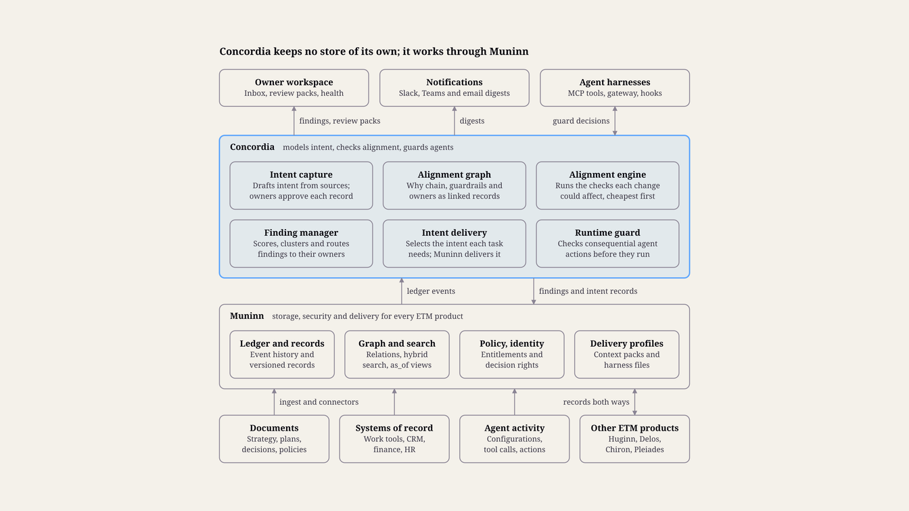
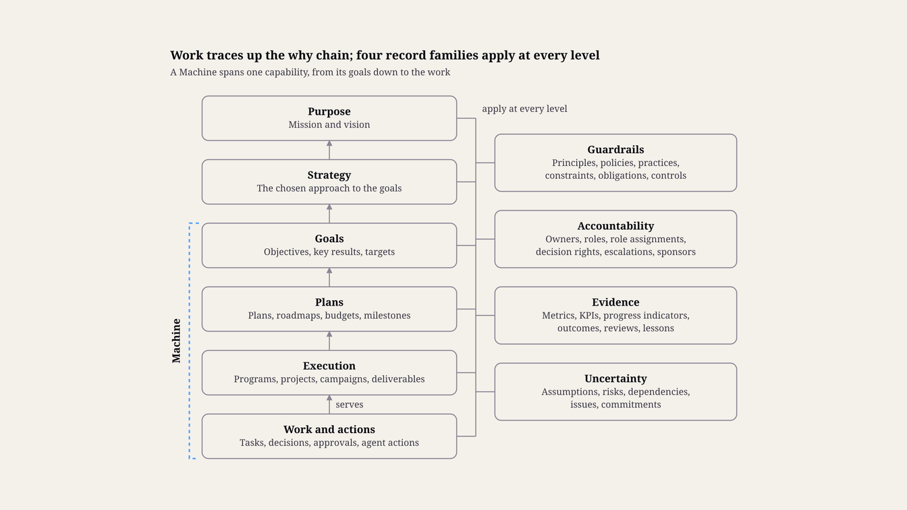
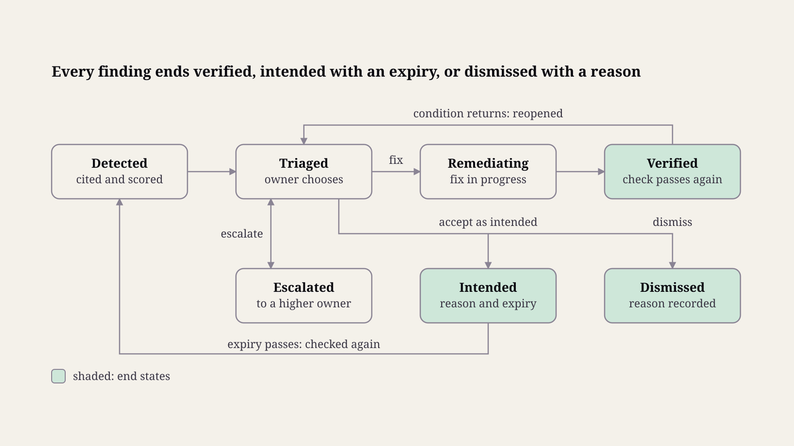

> Customer-facing copy of <https://www.etmpartnersllc.com/products/concordia>, captured 28 October 2026. The live website is the reference version.

# ETM Concordia™: Alignment System

## Summary and principles

Concordia keeps a company's people and AI systems working toward the same goals, plans and decisions. It holds the company's intent as an owned, versioned graph in Muninn, checks work and agent actions against that graph as they change, and sends each misalignment to the person accountable for it.

Concordia architecture · 6 services on Muninn

### What Concordia does

Models intent. Mission, strategy, goals, plans, budgets, decisions, policies, principles and decision rights become linked Muninn records, each with an accountable owner.

Checks alignment continuously. Every change to intent or to execution triggers the checks it could affect, so alignment does not wait for the quarterly review.

Aligns agents at runtime. Agents receive the intent that applies to their task, and consequential actions are checked against decision rights, policies and principles before they run.

Supports accountable people. Owners get a short inbox of findings with evidence and options, review packs for their regular meetings, and alignment health for the capabilities they run.

### Design principles

Intent is owned. Every goal, plan, policy and principle has an accountable owner and a review date. Concordia drafts intent from documents, but nothing becomes intent until its owner approves it.

Concordia surfaces; people decide. It raises findings with evidence and options and never rewrites a goal or plan itself. The only automatic enforcement happens at agent runtime, inside limits that owners set.

Evidence before judgment. Deterministic checks run first. Model judgment is used only where meaning matters, and every finding cites the records it rests on.

One standard for people and agents. Agents hold roles and decision rights as people do, and each agent has a human sponsor. Accountability always ends with a person.

Work is checked; people are not scored. Findings attach to goals, plans, decisions and agent actions. Concordia produces no individual performance ratings.

Deliberate deviation is allowed. An exception with an owner, a reason and an expiry is recorded alignment, not drift.

Quiet by default. Each owner has a noise budget, and findings with one cause collapse into one.

Built on Muninn. Intent, decisions and findings are Muninn records, so they inherit its security, history, entitlements and portability. Concordia adds models, checks and workflows, not another store.

## Architecture

Concordia is a set of services on top of Muninn. Muninn stores, secures and delivers knowledge; Concordia models intent, runs alignment checks, manages findings and guards agent actions.

Inputs reach Muninn through its ingest pipeline and connectors, never through a separate Concordia store. Concordia subscribes to Muninn's ledger events, re-checks the part of the alignment graph each change touches, and writes findings back as Muninn records. Owners act on findings in the Concordia workspace, while agents receive intent through Muninn's delivery profiles and meet the runtime guard at the MCP gateway or in harness hooks.

Everything outside Concordia connects to Muninn. Concordia reacts to Muninn's ledger events and writes findings and intent back as records.

### Interfaces

MCP tools for agents: concordia.why, concordia.check_action, concordia.findings, concordia.propose_intent and concordia.record_decision (see Aligning AI agents at runtime).

Workspace API for the web app and integrations, with notifications to Slack, Teams and email.

Muninn ledger subscription for change events, and Muninn's policy port for decision-rights checks.

### Deployment

Concordia deploys next to the client's Muninn, in the client's cloud or hosted by ETM, and uses Muninn's adapters for identity, policy, gateway and storage. Semantic checks call a model through a model port, so a client can keep model calls on its own approved provider or on models it hosts.

## The alignment model

Every piece of work should trace upward, through plans and goals, to the strategy and mission it serves. It should stay inside the guardrails that principles and policies set, with an accountable owner at each level. Concordia stores that chain as Muninn records and relations, using the built-in entity types.

Alignment model · 6 levels, 4 cross-cutting families

Arrows are con:serves links up the chain; the four families on the right attach to records at any level.

### The why chain

Intent runs in six levels. Lower levels serve higher ones through con:serves links, and a link may skip a level: a project can serve a goal directly.

Level| Built-in types| Typical owner| Review cadence  
---|---|---|---  
Purpose| MISSION, VISION| CEO and board| Yearly  
Strategy| STRATEGY| Executive team| Yearly, revisited each quarter  
Goals| GOAL, OBJECTIVE, KEY-RESULT, GOAL-SMART, GOAL-OPERATIONAL, TARGET| Executives and function heads| Each quarter  
Plans| PLAN, ROADMAP, BUDGET, MILESTONE| Function heads| Each month or quarter  
Execution| PROGRAM, PROJECT, CAMPAIGN, DELIVERABLE, ACTION-ITEM| Program and project owners| Continuous  
Work and actions| Tasks held in work tools (EXTERNAL-REFERENCE), DECISION, APPROVAL, agent actions (EPISODE)| People and agents doing the work| Continuous  
  
### Guardrails, accountability, evidence and uncertainty

Four families of records cut across every level:

Guardrails limit how intent may be pursued: PRINCIPLE, CULTURAL-PRINCIPLE, ETHICAL-PRINCIPLE, POLICY, CONSTRAINT, OBLIGATION, CONTROL, PRACTICE.

Accountability says who answers for what and who may decide: ACCOUNTABLE-OWNER, ROLE, ROLE-ASSIGNMENT, DECISION-RIGHT, ESCALATION, and AI-AGENT with its human sponsor.

Evidence shows whether intent is being met: METRIC, KPI, PROGRESS-INDICATOR, OUTCOME, REVIEW, LESSON.

Uncertainty records what could break a plan: ASSUMPTION, RISK, DEPENDENCY, ISSUE, COMMITMENT.

### The Machine

A Machine (MACHINE) is the unit Concordia aligns and reports on: one capability with its goals, outcomes, accountable owner, people and agents, processes and systems. Examples are Release software in engineering and Lead to opportunity in go-to-market.

Concordia checks alignment inside a Machine (does its work serve its goals?) and between Machines (one Machine's output is another's input, and their goals must not conflict). Health is reported per Machine, so each owner sees the capability they run rather than a company-wide list.

### Relations Concordia adds

Concordia reuses Muninn's core relations (supersedes, contradicts, derivedFrom, partOf, appliesTo) and adds a con: extension. Check ids are defined under Alignment checks.

Relation| From and to| Used by  
---|---|---  
con:serves| Work, plan or goal to the higher intent it serves| C1, C5, C6  
con:measuredBy| Goal or objective to a metric, key result or target| C2, C3  
con:fundedBy| Plan, program or project to a budget| C2, C7  
con:dependsOn| Work or deliverable to the work or deliverable it needs| C9  
con:commitsTo| Commitment to the deliverable or milestone it promises| C9  
con:assumes| Plan or decision to an assumption| C8  
con:constrainedBy| Plan, action or agent to a policy, constraint, obligation or principle| C10, C16, C17  
con:accountable, con:responsible, con:consulted, con:informed| Intent or work to a role assignment| C13, routing  
con:decidedUnder| Decision or approval to the decision right it used| C11  
con:boundTo| Agent configuration to the intent versions delivered to it| C18, C19  
  
### Fields Concordia adds to intent records

Intent records carry Muninn's envelope (owner, review date, validity, status and provenance). Concordia adds:

horizon: the TIME-PERIOD the intent covers.

weight: priority relative to sibling intents, used in severity scoring.

successCriteria: how achievement is judged, linked to measures.

machine: the Machine the intent belongs to.

enforcement: for policies and principles, one of observe, advise, approve or block (see Aligning AI agents at runtime).

examples: for principles, short compliant and violating examples. A model cannot check a principle that has no examples, so Concordia asks the owner for at least two of each.

## Inputs and keeping intent current

Concordia reads only through Muninn. Each source reaches Muninn through its ingest pipeline or a connector, as records or as references to a system of record, and Concordia sees only what its service identity is entitled to see.

### Sources

Source| What Concordia gets| Muninn class| Refresh  
---|---|---|---  
Strategy documents, board decks, planning memos| Mission, vision, strategy, objectives, plans| Intent| On change, owner-reviewed  
Goal and OKR tools| Objectives, key results, targets, progress| Intent| Daily sync  
Work tools such as Jira, Linear or Asana| Programs, projects, tasks, status, dates| Intent for projects and above, Reference for tasks| Webhooks  
Product and roadmap tools| Roadmap items, releases| Intent, Experiential| Webhooks or daily  
CRM| Accounts, opportunities, customer commitments| Reference, Intent for commitments| Webhooks or hourly  
Finance and budgeting| Budgets, actual spend| Intent for budgets, Factual for actuals| Monthly close  
HR system and identity provider| People, teams, roles, reporting lines| Factual| Daily  
Meeting notes, decision logs, ADRs| Decisions, action items, assumptions| Normative, Factual| On ingest  
Policy library and handbook| Policies, principles, obligations, controls, decision rights| Normative, Intent| Owner-reviewed  
Metrics and BI| KPI and metric values| Factual| Each refresh  
Agent harnesses and the MCP gateway| Agent configurations, tool calls, actions, delivery logs| Factual for configurations, Experiential for actions and logs| Streaming  
  
### Capturing intent

Draft from sources. Muninn's ingest extracts candidate intent records, each citing the source span it came from.

Owner review. The owner confirms, edits or rejects each candidate. Nothing is active until approved, matching Muninn's rule that every imported Normative record is reviewed.

Direct authoring. The workspace offers templates for a strategy on a page, an OKR set, a principle with examples and a decision record. An interviewing agent can also draft records from a conversation for the owner to approve.

Engagement kick-off. In an ETM engagement, the People and Process work produces the first mission, strategy, goals, principles and decision rights. Concordia starts from that, not from an empty graph.

### Keeping intent current

Review cycles. Each record's review date follows the cadence set in the alignment model, and a missed review raises C14.

Change propagation. When an intent record is superseded, Concordia lists everything that served or was bound to the old version, including plans, projects and agent configurations. It raises one finding for the change, not one per dependent.

Source drift. If a source document changes after extraction, Muninn proposes an update to the record and the owner decides.

History. Records are bi-temporal, so Muninn's as_of answers "what was the strategy when this decision was made?"

### Freshness of execution data

Every finding records the as-of time of each input it used, and a stale input lowers the finding's confidence. Past a connector's freshness limit, Concordia suspends the checks that depend on it and raises a finding to the connector's owner instead, because a silent connector looks like perfect alignment.

## Alignment checks

Concordia ships 20 built-in checks. They are grouped by dimension (goals, strategy, plans, decisions, accountability, and ethics and culture), plus agents, which cut across all of them.

ID| Dimension| Check| Question it answers| Method| Runs  
---|---|---|---|---|---  
C1| Goals| Orphan work| Does this project, campaign or agent workflow serve any active goal?| Structural| On change; weekly sweep  
C2| Goals| Unsupported goal| Does each active goal have an owner, a plan, a measure and funding?| Structural| On activation; at planning review  
C3| Goals| Off-track goal| Is a key result or target trending to miss by its date?| Quantitative| On metric refresh  
C4| Goals| Conflicting goals| Do two active goals pull against each other or claim the same capacity?| Semantic, quantitative| On goal change  
C5| Strategy| Strategy gap| Does every goal trace to a strategy, and does every strategy have goals?| Structural| At planning review  
C6| Strategy| Effort mismatch| Do spending and effort follow the strategy's stated priorities?| Quantitative| Monthly  
C7| Plans| Over-commitment| Does the plan need more people, money or time than it has?| Quantitative| On plan or budget change  
C8| Plans| Broken assumption| Does a plan or decision rest on an assumption that new facts contradict?| Semantic| On fact change  
C9| Plans| Commitment at risk| Will a slipping dependency or release break a promise to a customer or team?| Structural, quantitative| On change  
C10| Decisions| Contradicting decision| Does a new decision conflict with strategy, policy or an earlier decision?| Semantic| On decision recorded  
C11| Decisions| Decision outside rights| Was it made or approved by a person or agent without the right to make it?| Rights| On approval; pre-action  
C12| Decisions| Silent change| Did direction change, such as a roadmap item dropped, with no decision recorded?| Structural, semantic| Weekly  
C13| Accountability| Ownerless intent| Does every goal, plan, risk and commitment have an active accountable owner?| Structural| On change; on people changes  
C14| Accountability| Stale intent| Has intent passed its review date, or a plan outlived its period?| Structural| Daily  
C15| Accountability| Stalled follow-through| Are escalations and action items past due with no update?| Structural| Daily  
C16| Ethics and culture| Principle conflict| Do agent instructions, policies or plans conflict with an ethical or cultural principle?| Semantic| On change  
C17| Ethics and culture| Guardrail breach| Did an agent action or output break a policy, constraint or principle?| Rights, semantic| Pre-action for flagged actions; sampled after  
C18| Agents| Agent intent drift| Is an agent running on a superseded goal, policy or principle?| Structural| On intent change; on harness sync  
C19| Agents| Cross-system inconsistency| Do two agentic systems act on different versions of the same intent?| Structural| Daily  
C20| Agents| Unsponsored agent| Does every agent have a human sponsor, a role and decision rights?| Structural| On agent registration  
  
### Methods

Structural: a graph query over the alignment graph, such as a missing con:serves path. Cheap and exact, so it runs on every relevant change.

Quantitative: arithmetic on measures, capacity, budgets and dates, such as a key result's trend against its target.

Rights: a decision-rights query through Muninn's policy port: OpenFGA for who holds a right in which scope, Cedar for limits such as amounts.

Semantic: model judgment for questions of meaning, such as whether a decision contradicts a strategy. How it is constrained is described under From signal to finding.

### Checks are data

Each check is a versioned definition stored in Muninn: its query or prompt, thresholds, severity rule, triggers and owner. Clients can tune, disable or add checks. Domain packs add their own: the go-to-market pack adds discount outside authority and deal terms outside policy, and the engineering pack adds release with an open high risk and architecture decision bypassed.

## From signal to finding

Every finding comes through the same pipeline. A trigger scopes the part of the graph that changed, checks run cheapest first, and only cited, scored and clustered findings reach an owner.

### Pipeline

Trigger. A Muninn ledger event (a record admitted, superseded or retracted), a connector event, a schedule, review preparation or a pre-action request starts a run.

Scope. Concordia takes the changed record and its alignment neighborhood: records within a few hops along con:serves, con:dependsOn and con:constrainedBy. Only checks that read those records run.

Deterministic checks. Structural, quantitative and rights checks run first and settle most cases.

Semantic checks. Model judgment runs only on candidates a cheap filter selects, such as records with shared scope, shared entities or close embeddings. The model receives the evidence as data inside Muninn's data envelope and must return a structured verdict citing record ids and spans; a verdict without valid citations is dropped. A high-severity verdict needs agreement from a second, independent run before it reaches an owner.

Score. Each candidate gets a severity and a confidence (below).

Cluster. Candidates with one cause merge into one finding: a superseded goal with twelve projects still serving it is one finding with twelve subjects.

Route. The finding goes to the accountable owner of the highest intent involved, found through role assignments, with consulted roles copied. Non-critical findings beyond the owner's noise budget wait for the weekly digest.

### Scoring

severity = weight × impact × urgency

confidence = check precision × evidence freshness × agreement

Weight comes from the highest intent involved, impact is how much of that intent the finding puts at risk, and urgency rises as the intent's deadline approaches. Check precision is the share of that check's past findings that owners acted on rather than dismissed, so a noisy check loses influence on its own.

### The finding record

A finding is an ALIGNMENT-FINDING record with derivedFrom links to its evidence. If evidence is retracted, Muninn's taint propagation withdraws or reopens the finding without anyone chasing it.

Field| Content  
---|---  
Check| Check id and version  
Subjects| The records the finding is about  
Evidence| Records and source spans, each with its as-of time  
Explanation| Two or three plain sentences: what conflicts with what, and why it matters  
Options| Suggested remedies, such as re-link, re-plan, record an exception or escalate  
Severity and confidence| Scores and the inputs behind them  
Owner and due date| The routed owner and the date a response is due  
Status| Lifecycle state (below)  
Resolution| The decision, exception or change that closed it  
  
### Lifecycle

Owners move findings through a small set of states, drawn below. Three rules keep the states honest: Intended needs a reason and an expiry and creates a POLICY-EXCEPTION or DECISION record; Dismissed needs a reason, which feeds the check's precision; and only Concordia can mark a finding Verified, by re-running the check. A finding whose condition returns is reopened, not duplicated.

Finding lifecycle · 7 states, 3 end states

Concordia, not the owner, moves a finding from Remediating to Verified, by re-running its check.

## Aligning AI agents at runtime

Agents get the relevant intent before they work and meet a guard before consequential actions. Both run through Muninn's existing delivery and identity layers, so the same rules hold in every harness.

### Intent in every context pack

Muninn's context packs gain an intent header for planning and prioritization tasks: the goals the task serves, the guardrails that apply, and the decision rights of the agent's role. Goals and status travel as data. Approved principles and policies with enforcement of advise or stronger also render into a managed principles section of AGENTS.md and the matching harness files.

Every delivery is logged with the record versions it carried. That log is what C18 and C19 compare against current intent.

### Pre-action checks

Consequential actions are checked before they run. Each client chooses its action classes; the defaults are external communications, prices and discounts, spending, date or scope commitments to customers, changes to production systems, and deletion of records.

The caller sends an action descriptor: the agent, the person it acts for, the action class and parameters, the target, and the goal the agent believes the action serves. Concordia answers with one outcome and its reasons:

Outcome| Meaning  
---|---  
Allow| No guardrail applies, or every applicable one passes  
Advise| Allowed, with a note the agent should follow, such as a principle that applies  
Approve| The action waits for a person who holds the decision right  
Block| Refused, citing the policy, constraint or principle  
  
Rights and policy evaluation is deterministic, through Muninn's policy port, and semantic principle checks run only for action classes owners flag. A check that times out returns Approve, never Allow.

### Enforcement points and modes

Concordia enforces at the MCP gateway Muninn already deploys, as a policy callout on tool calls, and through harness hooks where a harness offers them, such as Claude Code's PreToolUse hook. Agents can also call concordia.check_action themselves, but that is advisory; only gateway and hook enforcement binds.

Each guardrail and action class has an enforcement mode set by its owner: observe, advise, approve or block. New rules start in observe, so their false-block rate is measured before they can stop anything.

### Agents are accountable actors

Every agent is registered as an AI-AGENT with a human sponsor, one or more roles, and the decision rights those roles carry. Muninn's token exchange keeps the act chain, so Concordia knows both the agent and the person it acts for, and an agent never holds a right its sponsor lacks. A missing sponsor or role raises C20.

### MCP tools

Tool| Purpose  
---|---  
concordia.why| Returns the path from a piece of work to the goals and strategy it serves, or says it serves none  
concordia.check_action| Pre-action check that returns allow, advise, approve or block with reasons  
concordia.findings| Lists open findings the caller may see for a record, Machine or owner  
concordia.propose_intent| Drafts an intent record or exception for its owner to approve  
concordia.record_decision| Records a decision with its rationale, the decision right used and the intent it affects  
  
## Accountability in practice

In Concordia, accountability means three things. Every goal, plan, risk and commitment has one accountable owner; every finding reaches that owner with what they need to act; and every deliberate deviation is recorded with a reason and an expiry.

### The owner inbox

Each owner sees findings on the intent they own, ranked by severity. Every finding offers the same actions: fix it (re-link, re-plan or update the record), accept it as intended with an expiry, dismiss it with a reason, delegate it to a responsible role, or escalate it. Each action is one step, and Concordia writes the resulting records.

### Planning pre-checks

A draft plan, OKR set or budget can be checked before approval. Concordia reports goals the draft leaves uncovered, conflicts with other teams' plans, missing owners and measures, and assumptions that facts already contradict, so problems are fixed before the plan goes live.

### Review packs

For each recurring review (weekly business review, monthly operating review, quarterly business review, board meeting), Concordia prepares a pack. It covers goal status, open findings by severity, decisions since the last review, changed assumptions and commitments at risk. Decisions and action items from the meeting go back into Muninn through the workspace, linked to the REVIEW record.

### Escalation

A finding not triaged by its due date escalates along the decision-rights chain, then the reporting line. Owners can escalate early when a fix needs authority they lack. Each step is an ESCALATION record, so the path and the delay stay visible.

### Alignment health

Health is reported per Machine and per goal, never per person:

Coverage: share of active projects, campaigns and agent workflows that serve an active goal.

Completeness: share of active intent with an owner and a measure, and, for plans, a budget.

Freshness: share of intent reviewed by its review date.

Open findings: count by severity and age.

Time to resolve: median days from detection to resolution.

Agent currency: share of agents running on the current version of the intent bound to them.

### The portfolio view

PE operating partners see one line per portfolio company: alignment health against its value creation plan, modeled as strategy, objectives and plans. Each company is its own Muninn tenant and publishes aggregate health only; finding details stay inside the company unless it chooses to share them.

## Trust, privacy and governance

Concordia sees much of a company's intent and execution, so it inherits every Muninn control and adds its own rules for people data, principles and explanations.

### Entitlements

Concordia reads through Muninn's entitlement filter, as a service identity acting for the user who asked or for the owner a finding is routed to. A finding's audience is the intersection of its evidence audiences. A reader who cannot see some of the evidence gets a redacted finding that names the gap and the owner to ask, never the hidden content.

### People data

Concordia checks work products: goals, plans, decisions, approvals and agent actions. It sees human activity only as records already held in systems of record.

It never reads private messages, keystrokes or screen activity.

It produces no per-person scores or rankings, and its health measures roll up to Machines and goals.

A deployment in a jurisdiction with works councils or employee-monitoring rules needs a review before go-live. ETM supplies a data protection impact assessment template.

### Governing principles

Named executives own the ethical and cultural principles, and a change needs approval from the CEO or the board, as the client decides. Every version is kept, so findings always cite the principle as it stood when the work happened.

### Explanations and contest

Every finding and every runtime decision carries a plain explanation and its citations. Anyone affected can contest one: a contested block goes to the guardrail's owner, and the outcome feeds the check's precision.

### Safety of Concordia itself

Model output never changes intent, closes a finding or relaxes a guardrail. Evidence reaches models as data inside Muninn's envelope, so instructions planted in a document cannot steer a check, and a planted "goal" cannot become intent without its owner's approval. Every Concordia decision goes to the Muninn audit log.

### Data residency

Concordia runs where the client's Muninn runs. Semantic checks call models through the model port, so a client can require its own approved provider or self-hosted models, and each call carries only the evidence that check needs.

## Working with the other ETM sponsored projects

Concordia depends on Muninn and trades work with the other four projects. Every exchange goes through Muninn records.

Project| What Concordia uses| What Concordia provides  
---|---|---  
Muninn| Ledger events, records, graph, policy port, identity, delivery profiles| An owned, populated Intent class, and alignment checks that complement the Steward's knowledge-quality checks  
Huginn| Deliberation on hard semantic findings, such as goals that conflict across contexts, and remedy options weighed against explicit criteria| The findings, intent and decision criteria to deliberate on  
Delos| Causal diagnosis of off-track goals, and tests of the assumptions plans rest on| Goals, targets, outcomes and the findings that need a cause  
Chiron| Alignment regression suites, run on every agent, model or prompt change| Test cases generated from principles, decision rights and past findings  
Pleiades| Migration of agents with their bindings intact| Checks that a migrated agent carries the same roles, rights and intent bindings, and passes the same alignment tests  
  
## Talk to ETM

See how ETM Concordia fits your company. [Schedule a Discussion](https://calendly.com/joe-etmpartners/30min) or write to joe@etmpartnersllc.com.
