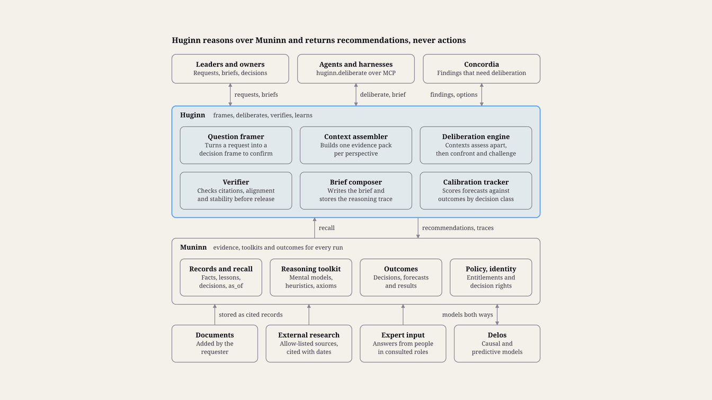
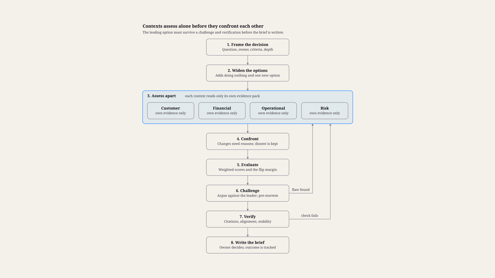

> Customer-facing copy of <https://www.etmpartnersllc.com/products/huginn>, captured 28 October 2026. The live website is the reference version.

# ETM Huginn™: Deliberation System

## Summary and principles

Huginn turns a decision question into a recommendation a leader can check. It frames the decision, reasons over the company's knowledge from several independent perspectives using the company's own mental models, tests the leading option against a challenge, and delivers a brief that shows the options, evidence, disagreements and confidence behind its answer.

Huginn architecture · 6 services on Muninn

### What Huginn does

Frames decisions. A request becomes a decision frame: the question, the decision owner, the deadline, the options already on the table, the criteria and their weights, and how hard the decision is to undo.

Deliberates across contexts. Several perspectives, such as customer, financial, operational and risk, each assess the options on their own evidence before they compare notes.

Delivers inspectable recommendations. The decision owner gets a brief with the recommendation, the options compared, the evidence cited, the disagreements kept and what would change the answer.

Learns from outcomes. Each recommendation carries forecasts. When results arrive, Huginn scores itself, so trust is earned one decision class at a time.

### Design principles

People decide. Huginn recommends and explains; it never acts on its own recommendations. Actions that follow a decision go through Concordia's guard.

Every claim is cited. A statement without a source is labeled as judgment, never presented as fact.

Contexts reason apart before they reason together. Each perspective forms its view on its own evidence first, so the loudest source cannot set the answer.

Disagreement is reported, not averaged away. Dissent stays in the brief with its reasons.

The company's own thinking comes first. Owned mental models, thought processes, heuristics and axioms guide the reasoning before generic ones.

Depth matches stakes. A small, reversible decision gets a quick pass; a large, hard-to-undo one gets the full deliberation.

"Not enough evidence" is a valid answer. Huginn then says what would settle the question instead of guessing.

Built on Muninn. Toolkits, recommendations and reasoning traces are Muninn records, so they inherit its security, history, entitlements and portability.

## Architecture

Huginn is a set of services on top of Muninn. Muninn holds what the company knows and how it prefers to reason; Huginn frames decisions, assembles evidence, runs the deliberation, verifies the result and tracks how its recommendations turn out.

A request comes from a leader in the workspace, from an agent through MCP, or from Concordia when a finding needs deliberation. Huginn recalls evidence through Muninn's entitlement filter, writes the recommendation and its reasoning trace back as records, and returns a brief. It changes nothing outside its own outputs.

Every source reaches Huginn as a cited Muninn record, and everything Huginn produces goes back to Muninn the same way.

### Interfaces

Workspace for leaders: requests, briefs, follow-up questions and decisions, with notifications to Slack, Teams and email.

MCP tools for agents: huginn.deliberate, huginn.brief, huginn.challenge, huginn.what_if and huginn.toolkit (see The recommendation brief).

Open-Source Project links: Muninn recall and records, Concordia's intent and alignment check, and Delos's causal models.

### Deployment

Huginn deploys next to the client's Muninn, in the client's cloud or hosted by ETM. Model calls go through the same model port as Concordia's, so a client can keep reasoning on its approved provider or on models it hosts.

## The reasoning toolkit

In Huginn, "advanced reasoning" means reasoning that follows explicit structures the company owns, rather than one free-form answer. Those structures are Muninn records of the built-in types in the Huginn category of the taxonomy, so they are versioned, reviewed and reusable by any agent.

Type| What it holds| Illustrative example for a pricing decision  
---|---|---  
AXIOM| Premises taken as true for this company| "We do not sell any product below cost."  
HEURISTIC| Rules of thumb, each with when it applies and when it fails| "Prefer annual prepayment over a deeper discount."  
THOUGHT-PROCESS| Ordered reasoning steps for a kind of decision| Frame, check precedent, model margin, test customer impact, recommend  
MENTAL-MODEL| A bundle for one domain: ontologies, causal and state models, axioms, heuristics, criteria and thought processes| The company's pricing model  
CRITERION| A factor for comparing options, with its weight| Gross margin, win rate, customer lifetime value, strategic fit  
PROMPT-TEMPLATE, AGENT-GUIDANCE| How each context agent is instructed| The financial perspective's lens  
  
### Generic and company models

ETM ships a starter library of generic thinking tools that apply to most decisions, such as base rates, second-order effects, opportunity cost, reversibility and the pre-mortem. A client's own models take precedence: Huginn applies the company's pricing model before any generic one, and the brief lists the models it used.

### Owned and tested

Every toolkit record has an owner and a review date, and a change needs the owner's approval, as Concordia requires for intent. Heuristics and axioms also build a track record: when a recommendation that relied on one is scored against its outcome (see Calibration and evaluation), the result is attached to it, so owners can see which rules of thumb hold up.

### Records Huginn writes

RECOMMENDATION: the answer, linked to its decision frame, the OPTION records considered and the CRITERION records used, with confidence and forecasts.

EPISODE: the full reasoning trace, with each context's assessment and each challenge round.

DECISION: written when the owner decides, through concordia.record_decision, and linked to the recommendation.

OUTCOME and LESSON: written when results are scored.

### Relations Huginn adds

Huginn reuses Muninn's core relations (supports, contradicts, derivedFrom, partOf) and adds a hug: extension:

Relation| From and to  
---|---  
hug:considers| Recommendation to each option it weighed  
hug:recommends| Recommendation to the option it favors  
hug:scoredOn| Option to a criterion, with the score, the context that gave it and its evidence  
hug:dissents| A context's assessment to the option it argued against  
hug:usedToolkit| Recommendation to the toolkit versions it applied  
hug:forecasts| Recommendation to the metric or outcome it predicts, with a range or probability and a check date  
  
## Contexts and sources

Huginn reasons mostly over Muninn: the company's facts, lessons, decisions, policies and intent. A context is a perspective with its own evidence: a lens that says what the perspective cares about, the criteria it judges, and an evidence pack assembled for it.

### Default contexts

Context| Question it asks| Typical evidence  
---|---|---  
Customer| What changes for customers, and how will they respond?| Account facts, support cases, win and loss lessons, research  
Financial| What does each option cost and return, and when?| Budgets, actuals, pricing records, forecasts  
Operational| Can we deliver it, and what does it displace?| Capacity, plans, commitments, dependencies  
Technical| What does it take to build or run, and what does it lock in?| Architecture decisions, components, incidents  
Risk and compliance| What could go wrong, and which obligations apply?| Risks, policies, obligations, controls  
Strategic fit| Which goals does it serve, and which principles does it touch?| Concordia intent: strategy, objectives, principles, decision rights  
  
Each decision class has a default set of contexts (see Decisions Huginn serves), and the decision owner can add or remove contexts when the decision is framed.

### Sources

Source| Reached through| How it is cited  
---|---|---  
Company knowledge| Muninn recall, filtered by entitlements| Record id, version and as-of time  
Intent and decision rights| Concordia| Intent record and version  
Causal and predictive models| Delos| Model id, version and the inputs used  
Systems of record| Muninn references to CRM, finance and product analytics| Reference and snapshot time  
External research| Allow-listed web sources, stored in Muninn as references| URL, publisher and retrieval date  
Expert input| A question sent to a named person in a consulted role| The person's answer, recorded as a source  
Documents the requester adds| Muninn ingest| Document and span  
  
### Evidence packs

The context assembler builds each pack with Muninn's recall pipeline, using a deliberation purpose and the context's lens as the query. Every item keeps its provenance and as-of time, and external content travels as data inside Muninn's envelope.

When a context's evidence is too thin to support a view, the context says so instead of filling the gap, and the brief lists what is missing.

## The deliberation process

In Huginn, multi-context deliberation is a fixed sequence: frame the decision, let each context assess the options alone, bring the assessments together, attack the leading option, verify the result, then write the brief.

Deliberation flow · 8 steps, 2 loops back

A flaw found in the challenge, or a failed check, sends the run back to the contexts with the new evidence.

### Steps

Frame. The request becomes a decision frame that the requester confirms. Missing parts, such as the decision owner or the criteria weights, are asked for, not assumed.

Widen the options. Huginn adds options the request missed, always including doing nothing and at least one option outside the obvious set.

Assess apart. Each context agent reads only its own evidence pack, scores every option on its criteria and gives cited reasons. No context sees the requester's preferred option or the other contexts' views yet.

Confront. A moderator shows each context the others' assessments. Contexts may revise their scores, but every change needs a stated reason, and disagreements that remain are recorded as dissent.

Evaluate. Options are ranked by weighted score across the criteria. Huginn also computes the flip margin: the smallest change in a weight or an assumption that would change the top option.

Challenge. A challenger argues against the leading option and runs a pre-mortem: assume the option failed a year from now, and explain why. If the challenge exposes a flaw the evaluation missed, the run returns to step 3 with the new evidence.

Verify. Each claim's citation is checked against its source, Concordia checks each option against intent, principles and decision rights, and a rephrased run tests whether the answer is stable. A failed check also sends the run back to step 3, with the failure attached as evidence.

Write the brief. The synthesis becomes the recommendation brief (see The recommendation brief), and the full trace is stored as an EPISODE.

### Scoring

score(o) = sum over criteria c of w_c × s_c(o)

Here w_c is the decision owner's weight for criterion c, and s_c(o) is the option's score on that criterion, averaged across the contexts that judge it. The flip margin is reported beside the ranking, because a narrow margin tells the owner the choice depends on judgment the numbers cannot settle.

### When a run stops

A run stops when the verifier passes and a confrontation round adds no new argument, or when its depth budget runs out. A run that stops on budget says so in the brief. If the evidence is too thin at framing, Huginn returns a request for information instead of a recommendation.

## The recommendation brief

The decision owner sees the reasoning in three layers: a one-page brief, the evidence behind each line of it, and the full trace for anyone who needs to audit the run.

### What the brief shows

Part| What it shows  
---|---  
Recommendation| The favored option in one sentence, with confidence as a probability and a plain label  
Options compared| Every option against every criterion, with scores, weights and links to evidence  
Why| The reasons that decide the ranking, each cited  
Where contexts disagree| Dissenting views, which context holds them and why  
What would change the answer| The flip margin, the assumptions the answer rests on, and the evidence that would overturn it  
Risks and pre-mortem| The main ways the recommended option could fail, and early warning signs  
Alignment| The goals served, the principles and policies checked, and who holds the decision right  
Forecasts and review date| What should happen if the option is chosen, and when Huginn will check  
Provenance| Sources and as-of times, toolkit versions, depth, models used and cost  
  
### Inspecting the reasoning

Drill-down: every line of the brief opens the evidence and the context assessment behind it.

What-if: the owner can change a weight or an assumption and see whether the ranking changes, without a new full run.

Follow-up: questions about the brief are answered from the same trace and evidence, and recorded with it.

Divergence note: when the recommendation differs from the option the requester said they preferred, the brief says so plainly.

### For agents

Agents get the same content as structured data:

Tool| Purpose  
---|---  
huginn.deliberate| Starts a deliberation from a decision frame; returns the brief, or a job id for deep runs  
huginn.brief| Returns a brief and its trace by id  
huginn.challenge| Runs the challenge and pre-mortem steps against a proposal the caller already has  
huginn.what_if| Re-ranks options under changed weights or assumptions  
huginn.toolkit| Lists the mental models and thought processes that apply to a question  
  
### Delivery

Briefs appear in the workspace and can be exported as a Claude doc or a Google Doc, with a short summary sent to Slack, Teams or email. The decision itself is recorded through Concordia, which links the decision, the recommendation and the decision right used.

## Decisions Huginn serves

Huginn is built for decisions that are consequential, have several credible options, and draw on knowledge spread across the company. Each decision class has a default depth and default contexts, which the decision owner can change.

Decision class| Examples| Default depth| Default contexts  
---|---|---|---  
Strategy and portfolio| Market entry, product bets, value creation plan priorities, acquisition screening| Deep| Strategic fit, financial, customer, risk  
Commercial| Pricing and packaging, discount and deal-term approvals, segment priorities| Standard| Customer, financial, risk  
Product and engineering| Roadmap priority, build, buy or partner, architecture decisions, release go or no-go| Standard| Technical, customer, operational  
Operations| Vendor selection, process changes, capacity plans, incident response options| Quick or Standard| Operational, financial, risk  
Alignment conflicts| Conflicting goals and remedies for findings, sent by Concordia| Standard| The contexts of the goals' owners  
Agent escalations| A hard choice an agent's harness routes to Huginn| Quick| Set by the task  
  
### Depth levels

Depth| Used for| What runs  
---|---|---  
Quick| Reversible, low-stakes choices and agent escalations| One pass with the relevant toolkit, cited, with no confrontation round  
Standard| Most consequential decisions| Every step, with one confrontation and one challenge round  
Deep| Large or hard-to-undo decisions| Several rounds, different models across contexts, Delos predictions and expert input  
  
Reversibility and stakes set the default depth. The framer asks how costly the decision would be to undo and how much is at stake, then suggests a depth the owner can change.

### Out of scope by default

Recommendations about individual people, such as hiring, promotion, termination or pay, are out of scope by default. Several jurisdictions treat AI use in employment decisions as high-risk, and these decisions need human judgment a brief cannot carry. Organization-level questions, such as how to structure a team, stay in scope.

## Calibration and evaluation

Huginn is judged on whether its recommendations hold up: whether leaders find them useful, whether their claims are faithful to their sources, and whether their forecasts come true.

### Forecasts and outcomes

Every recommendation states forecasts: what should happen if the option is chosen, with a probability or range and a check date. At the check date, Huginn reads the outcome through Muninn or Delos and scores each forecast. Calibration is reported per decision class with the Brier score:

Brier = (1/N) × sum over i = 1 to N of (p_i − o_i)²

Here p_i is the stated probability and o_i is 1 if the event happened and 0 if not; lower is better. A class with weak calibration shows lower confidence in its briefs until it improves.

Huginn also records whether the owner chose the recommended option and how each choice turned out. It is not scored on agreement: an owner who overrules it and is proved right is useful evidence about where its reasoning falls short.

### Backtests without hindsight

Chiron replays past company decisions whose outcomes are known. Because Muninn records are bi-temporal, a backtest reasons only over what the company knew on the decision date, using as_of, so later facts cannot leak into the replay.

### Measures

Measure| Definition  
---|---  
Citation faithfulness| Share of sampled cited claims whose source supports them  
Usefulness| Decision owners' rating of the brief, on a five-point scale  
Option coverage| Share of reviewed briefs where experts found no missing credible option  
Stability| Share of rephrased runs that recommend the same option  
Calibration| Brier score per decision class, once the class has enough scored forecasts  
Order bias| Change in the recommendation when option order is shuffled  
Time and cost| Per depth level  
  
### Adversarial tests

Chiron's suites also plant misleading sources and injected instructions in evidence packs. A run passes only if its recommendation does not change and the planted material is flagged in the brief.

## Trust, safety and governance

Huginn shapes decisions without making them, so its safeguards target the ways a recommendation can mislead: hidden bias, unsupported claims, leaked information and overconfidence.

### Recommendations, not actions

Huginn has no tools that change anything outside its own records. A person records the decision through Concordia, and any agent action that follows meets Concordia's guard and decision rights.

### Entitlements

Huginn reasons only over records that both the requester and the decision owner may see, and a brief's audience is the intersection of its evidence audiences, as with Concordia findings. If restricted evidence would matter, the brief says that relevant restricted material exists and names its owner, without revealing it.

### Bias controls

Context agents assess blind to the requester's preference and to each other's first views.

Option order is shuffled between contexts and between runs.

Each option is argued at its strongest before it is judged.

In Deep runs, contexts use different models where the client allows, to reduce shared blind spots.

### Injection and source quality

Evidence reaches models as data inside Muninn's envelope, so instructions planted in a source cannot steer a run. External sources carry a trust level and a retrieval date, and a claim resting only on low-trust sources is flagged in the brief.

### Honest uncertainty

Confidence is shown as a probability and a plain label, and it is lowered for decision classes with weak calibration. When evidence is thin, Huginn recommends what to find out first, with the cost of waiting, instead of picking an option.

### Cost and reproducibility

Each depth level has a budget, and a Deep run above a set cost needs approval. Every run pins its toolkit versions, model versions and source as-of times, so it can be replayed exactly for an audit, and every run is written to the Muninn audit log.

## Working with the other ETM sponsored projects

Huginn depends on Muninn and trades work with the other four projects. Every exchange goes through Muninn records.

Project| What Huginn uses| What Huginn provides  
---|---|---  
Muninn| Recall, records, toolkit storage, identity and entitlements, and as_of history| Recommendations, reasoning traces, decisions with their rationale, and lessons  
Concordia| Intent, principles and decision rights; the alignment check for each option; findings that need deliberation| Recommendations on conflicting goals and on remedies for findings, each weighed against explicit criteria  
Delos| Causal and predictive models to estimate each option's effects, and diagnosis of outcomes| Decisions and forecasts to test, and the factors each recommendation relied on  
Chiron| Backtests and stability, bias and injection suites, run on every toolkit or model change| Test cases drawn from past briefs and decisions  
Pleiades| Movement of deliberation workflows and toolkits between systems| Thought processes packaged as portable skills, and deliberation on hard migration choices, such as which system to standardize on or whether to bridge or rebuild an agent  
  
## Talk to ETM

See how ETM Huginn fits your company. [Schedule a Discussion](https://calendly.com/joe-etmpartners/30min) or write to joe@etmpartnersllc.com.
