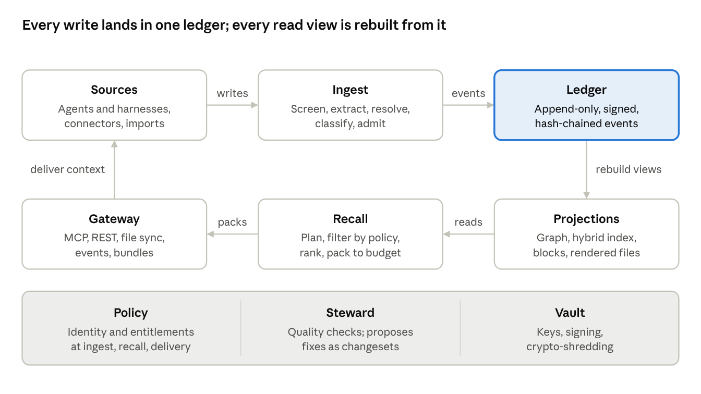
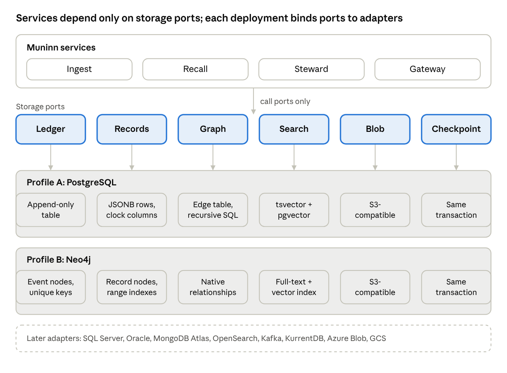

> Customer-facing copy of <https://www.etmpartnersllc.com/products/muninn>, captured 28 October 2026. The live website is the reference version.

# ETM Muninn™: Shared Agent Memory System Design

## Summary and principles

Muninn is a federated, event-sourced knowledge service. Agents and harnesses read and write it through MCP, APIs and generated harness files. It stores typed, provenance-carrying claims, not a copy of every system's data. Every change is an immutable event, so any view can be rebuilt, replayed or rolled back.

Muninn builds on existing specifications (PAM, MacPaw Portable Memory, COGX, MIF, Graphiti) and closes the gaps they leave open: cross-agent write conflicts, poisoning, erasure versus audit, and lossy migration.

Design principles:

  1. **The ledger is the truth; everything else is a projection.** Graph, vector, text and file views are rebuilt from an append-only event log. This gives idempotency, rollback and as-of queries for free.
  2. **Natural-language content is canonical.** Embeddings, summaries and indexes are derived and regenerable, so model changes never strand knowledge.
  3. **Every record carries provenance, two clocks, a scope and a sensitivity label.** Nothing enters without knowing who said it, when it was true, who may see it, and what it was derived from.
  4. **Memory is data, never instructions.** Retrieved content is delivered inside a data envelope. Only approved normative records reach a harness's instruction channel.
  5. **Reference, don't copy.** Muninn points to authoritative systems and caches snapshots with a freshness contract, rather than becoming a competing source of truth.
  6. **Agents never exceed their principal.** Access is the intersection of the delegating humans’ rights, the agent's grant, the stated purpose and the data's label.
  7. **Standards over invention.** The schema is authored in LinkML, aligned to W3C PROV-O and OWL-Time, and ships crosswalks to PAM, MacPaw .mem, COGX and MIF. MCP is the primary access surface.

Muninn architecture · write path, read path, cross-cutting servicesWrites run left to right into the ledger; reads run right to left from projections back to the agents. Policy, Steward and Vault apply across both paths.

## How knowledge is organized in ETM Muninn

Knowledge is organized as a typed, bi-temporal graph of records, partitioned into owned namespaces. Each record wraps one claim in a fixed envelope; classes say what the claim is for, relations say how claims connect.

### Containment

From smallest to largest:

  1. **Statement** : one atomic claim, ideally subject–predicate–object plus a natural-language sentence.
  2. **Record** : the unit of storage, versioning and access. It holds one statement plus its envelope.
  3. **Collection** : an ordered group of records that travel together (an episode transcript, a Letta-style block, an ADR, a skill).
  4. **Namespace** : a hierarchical path with an owner, e.g. acme/platform/payments-api/agent:reviewer.
  5. **Tenant** : the hard isolation boundary, with its own keys.

A **Bundle** is a signed export of any set of records; it is not a storage tier.

### Entities and relations

Entities (people, services, repos, components, customers, concepts) are first-class nodes with canonical ids, aliases and external identifiers. Records attach to entities through about edges, which makes structured questions possible: "all active constraints on component X."

The core relation set is closed: about, supports, contradicts, supersedes, extends, derivedFrom, partOf, causedBy, appliesTo, references, duplicateOf, sameAs. Edges carry their own confidence and validity. New relation types go through a registry, as PAM does for types.

### Domain extensions

Domains add vocabulary in their own prefix, such as swe: for architecture records or sec: for security findings. Each extension ships SHACL shapes, so it is validated but never forces a core change. Unknown extensions survive every import, export and upgrade untouched.

### Schema source

The whole model is authored once in LinkML. From it Muninn generates JSON Schema, SHACL shapes, a JSON-LD context, and Python and TypeScript types. Records also render to Markdown with YAML frontmatter, so humans and git can read them.

[ETM Muninn™: Built-In Entity Types](https://www.etmpartnersllc.com/products/muninn/entity-types)

## How new knowledge is added

All writes, from any path, become **proposals** that pass one ingest pipeline before they are committed to the ledger. Raw sources are kept immutable; extracted claims cite the exact span they came from.

Every proposal carries an idempotency key, a principal and delegation chain, a purpose, and a changeset id. A changeset groups everything one session, job or import produced, so it can be reviewed or reverted as a unit.

### Algorithms: the ingest pipeline

  1. **Screen.** Detect and strip secrets (replaced by a vault SecretRef) and tag PII before anything is stored or sent to a model. Flag imperative, instruction-shaped text arriving as data, a common injection signature.
  2. **Segment and store the source.** Episodes are chunked and stored immutably with offsets. They are the evidence every extracted claim must point back to.
  3. **Extract.** A model with schema-constrained output proposes typed statements. Each must cite a source span; uncited statements are dropped. Cheap models do the first pass and escalate low-confidence items to stronger ones.
  4. **Normalize.** Canonicalize wording, build the triple where possible, set the language tag, and resolve time expressions. timeSource records whether validity was stated in the source, inferred, or defaulted to ingest time.
  5. **Resolve entities.** Block candidates by exact alias, external id and embedding neighbors; adjudicate with features plus a model. Below the merge threshold, create a new entity linked by a tentative sameAs for later review.
  6. **Relate to existing knowledge.** Retrieve the top-k similar active records in overlapping scopes. Classify the new statement against each: duplicate, refines, extends, contradicts, supersedes or independent.
  7. **Apply the relation outcome.**
     * Duplicate: no new record. Append a Reinforced event that adds provenance and raises confidence.
     * Refines/extends: new record linked by extends.
     * Supersedes: new record, old one set to superseded with retiredAt; old validity is closed, not deleted.
     * Contradicts: both kept, linked, and marked contested unless the conflict policy resolves it (see the Conflicts check under Automated quality checks).
  8. **Classify and label.** Assign class, namespace, audience and sensitivity. The label is the highest label among its sources (high-water mark), so derivation can never declassify.
  9. **Score confidence.** Combine a source-trust prior, extraction confidence and corroboration count. Priors, highest first: authoritative system, human, agent-verified (tested or observed), agent-inferred.
  10. **Admit.** Apply the admission policy for the class, namespace and risk. Approved proposals become active; others wait as candidate in a review queue.
  11. **Commit.** Append the events to the ledger. Projections and indexes update asynchronously and report their lag.

### Write governance

  * **Rate and volume budgets** per agent and namespace, so a looping agent cannot flood shared memory.
  * **Write scopes** : an agent may propose into any namespace it can write, but may only auto-admit into scopes its policy names.
  * **Quality gates on proposals** : minimum grounding, maximum length, required fields per subtype (a Decision needs a rationale).
  * **Feedback to writers** : rejected or merged proposals return the reason, so harnesses can learn what is worth saving.

## Changing knowledge with idempotency and rollback

Knowledge is never edited in place. Every change is an immutable, signed event in an append-only ledger; a record's current state is a fold over its events. Rollback is therefore a new compensating event, which is itself audited and reversible.

### Idempotency

  * **Idempotency keys.** Each proposal carries a key, by default a hash of source id, operation and normalized payload. The ledger rejects a second event with the same key and returns the original result.
  * **Deterministic ids on import.** Imported records get UUIDv5 ids derived from source system and source id. Re-running an import is a no-op; re-running after a source change produces revisions, not duplicates.
  * **Commutative merges.** Reinforcement is a set union of provenance and supersession is an explicit edge. Replaying the same events in a different order gives the same state, so retries and multi-writer sync are safe.
  * **Optimistic concurrency.** Writes to an existing record carry the version they read. A stale version gets a conflict response with the current state, never a silent overwrite.

### Two clocks

Each record keeps world time (validFrom/validTo) and system time (recordedAt/retiredAt). Recall can therefore answer "what is true now," "what was true on 1 March," and "what did Muninn believe on 1 March." The third question is what makes incident review and rollback auditable.

### Rollback granularity

  1. **One event.** Revert a single revision, retraction or reclassification.
  2. **One changeset.** Revert everything a session, agent run, import or connector batch produced. This is the main defense against a poisoned or hallucinating session.
  3. **A namespace to a point in time.** Compute the namespace state at system time T, then append compensating events to restore it.
  4. **Branches.** Large or risky changes (bulk imports, schema migrations, re-extraction with a new model) happen on a branch. A branch is reviewed, diffed and merged, as in git or AMFS.

Reverting a source does not silently leave its derivatives standing. Muninn walks derivedFrom edges and marks dependents for re-evaluation (taint propagation), and the Steward reprocesses them.

### Erasure without breaking the audit trail

Retraction and erasure are different states. Retraction hides a wrong claim but keeps it for audit. Erasure, for legal or contractual deletion, uses crypto-shredding:

  * Restricted and personal records encrypt their payload with a per-record data key.
  * Erased destroys that key and records a tombstone holding only the id, hash and reason.
  * Projections, indexes, embeddings and caches receive the tombstone first on every rebuild or import, and report proof of removal.
  * Backups hold only ciphertext, so key destruction also erases them.

This resolves the conflict between PAM (never physically delete) and MacPaw and the W3C group (verifiable erasure).

### Schema evolution

Events are versioned against the LinkML schema. Old events are upcast on read, so the ledger is never rewritten when the schema changes.

## Finding the right knowledge at the right time for the right reasons

Recall combines three timings (standing, triggered, on-demand) with one pipeline that filters by entitlement before it ranks. Every request states its purpose, and every returned item says why it was chosen.

### When knowledge is pulled

Standing context is small and stable, so it can be cached and rendered into harness files. Triggered recall supplies most of the value, because it arrives exactly when the agent is about to act.

Timing | Trigger | What is returned  
---|---|---  
Standing context | Session start for a given principal, harness and project | Identity and preferences, approved instructions and constraints, active decisions for the scope, open handoffs  
Triggered | Harness hooks: task assigned, file or path touched, tool error, test failure, entity mentioned | Small, targeted packs keyed to what just happened (e.g. constraints on the component being edited)  
On demand | Agent calls recall, query, as_of or explain | Whatever the agent asked for, within its entitlements  
  
### Every request carries context and purpose

A recall request includes: principal and delegation chain, harness and model, namespace path, anchor entities, task type, time point (default now), token budget, and a purpose code such as code-change, customer-reply or incident. Purpose feeds both entitlement (purpose-based access) and ranking.

### The recall pipeline

  1. **Understand the query.** Extract entities, time scope, and which classes are needed. "How should I…" favors procedures and constraints; "what is…" favors facts.
  2. **Generate candidates from several retrievers at once:**
     * lexical (BM25) for names, codes and error strings;
     * vector search for paraphrase;
     * graph traversal from anchor entities (about, appliesTo, partOf);
     * scope inheritance, walking up the namespace path so team and org knowledge applies to a project.
  3. **Filter before ranking.** Drop anything the caller is not entitled to, anything not active or contested, and anything not valid at the requested time. Filtering first means ranking signals can never leak restricted content.
  4. **Rerank.** A cross-encoder or small model scores relevance, then a policy blends in scope proximity, authority, confidence, recency, class priority, and past utility.
  5. **Resolve precedence among conflicting items:**
     * narrower scope beats broader;
     * an authoritative reference beats an agent claim;
     * the later valid statement beats the earlier;
     * otherwise both are returned, marked contested.
  6. **Diversify and pack.** Remove near-duplicates, then pack to the token budget with progressive disclosure: headline, summary, full text, each item expandable by handle.

### Structured questions are not similarity questions

Some questions need completeness or absence: "all active constraints on the payments service," "is there any decision about retries?" These go to a graph query tool (muninn.query) with explicit filters, not vector search. MOOSEDev's evaluation found typed, supersession-aware graphs answered such questions almost completely, while vector memory surfaced a small fraction.

### The right reasons: explanation and feedback

Each returned item carries a why: which retriever matched, which anchor, its provenance and its confidence. Agents can cite it, and humans can audit it.

Harnesses report back whether each item was used, ignored or wrong. Those signals update a per-record utility score and feed the Steward's low-utility and miscategorization checks. Recall quality is measured continuously against a per-domain evaluation set of competency questions.

## Delivering knowledge to agentic systems

Recall always produces one neutral **Context Pack** ; a **delivery profile** then renders it for a specific harness, model and channel. This keeps retrieval logic in one place while letting format, placement and size vary per consumer.

### Channels

Channel | Used for | Notes  
---|---|---  
MCP server | Primary channel for any MCP-capable harness | Tools: recall, query, remember, supersede, link, as_of, explain, feedback. Resources: muninn://<namespace>/.... Prompts: session bootstrap  
File projection | Always-on instructions and skills; harnesses without MCP | Renders managed sections of AGENTS.md, CLAUDE.md, GEMINI.md, .cursor/rules/*.mdc, and SKILL.md directories  
REST / gRPC | Frameworks (LangGraph, CrewAI, AutoGen, Strands) and services | Store adapters for each framework's memory interface  
Event stream | Subscriptions to a namespace or entity | Webhooks or SSE; lets long-running agents react to superseded decisions  
Bundles | Migration, backup, offline use | PAM, MacPaw .mem, COGX, MIF, Muninn native; signed  
  
File projections are generated, never hand-edited in place. Muninn writes between marked fences, so human-authored parts of AGENTS.md stay untouched. Edits inside the fence are detected on the next sync and turned into proposals.

### Data, not instructions

Retrieved items are wrapped in a typed envelope that marks them as reference data. Role markers inside content are escaped. Only active, approved Normative records may be rendered into an instruction channel, which closes the main path for memory-borne prompt injection.

### Tuning profiles

Profiles are versioned and evaluated like code. Each change is A/B tested on a task suite, measuring task success, tokens used, citation of delivered items, and errors attributable to missing or wrong context. A model upgrade triggers re-evaluation of its profiles.

## Security at rest and in transit

Every hop is mutually authenticated and encrypted, every stored byte is encrypted under keys Muninn can destroy selectively, and every record is signed by its writer. Derived artifacts such as embeddings get the same protection as the text they came from.

### In transit

  * TLS 1.3 on every connection; mutual TLS between Muninn services, using workload identities (SPIFFE/SPIRE or the cloud equivalent).
  * Remote MCP over HTTPS through the enterprise MCP gateway, following the MCP 2026-07-28 authorization spec: audience-bound tokens (RFC 8707), protected-resource metadata, and no token passthrough. A local stdio proxy is used only where a harness cannot reach a remote server, and it authenticates with the user's delegated token, never a shared static key.
  * Event streams and webhooks are signed, so subscribers can verify origin and reject replays.

### Secrets and sensitive content

Muninn never stores secrets. Ingest screening replaces them with a SecretRef pointing to the organization's vault, with metadata only. PII is tagged at ingest so labels, retention and erasure can follow it.

### Integrity and portability

Exported bundles are signed (Ed25519) and checksummed. On import, signatures and tombstones are verified first; unsigned or invalid bundles are quarantined. The audit log is a separate append-only store with its own keys, so compromising the data plane cannot rewrite history.

### Optional hardening

For Restricted tiers, recall and extraction can run inside confidential-computing enclaves, so plaintext is never visible to the host. This adds latency and cost, so it is a per-namespace option, not a default.

## Identity and entitlement

Muninn does not run its own identity system. It plugs into the enterprise's five-layer agent-access architecture: the IdP decides who may reach Muninn, an MCP gateway exchanges tokens and enforces per-call policy, and Muninn's Policy service decides which records each caller may see. An agent's effective access is still the **intersection** of its principal's rights, its own grant, the request's purpose and the data's label.

No single standard covers every harness as of October 2026. [MCP Enterprise-Managed Authorization](https://modelcontextprotocol.io/extensions/auth/enterprise-managed-authorization) (EMA) went stable on 18 June 2026, but only Claude, Claude Code, Cowork and VS Code support it as clients, and Okta is the only production IdP. Cursor, Codex and Gemini CLI do not. Muninn therefore supports EMA as the preferred path and a gateway path for everything else.

### Pluggable policy engines

Policy engines are a deployment-time binding, exactly like storage. Muninn ships defaults, OpenFGA for relationships and Cedar for attributes and per-call rules, but customers bind to the engines they already run. Muninn's access semantics stay fixed whichever engine expresses them.

The policy port has four calls:

Call | Returns | Used by  
---|---|---  
check(subject, action, resource, context) | Allow or deny, with a reason and policy version | Gateway per-call checks; final re-check of each pack  
listNamespaces(subject, action) | The namespaces the subject may act on, plus a consistency token | Recall pre-filtering; file projection audiences  
filterPredicate(subject, action, context) | A backend-neutral predicate over namespace, label, compartment and purpose | Pushed down to the storage port before ranking  
syncRelationships(changes) | Acknowledgement and position | Keeps the engine's membership and ownership data current  
  
Adapters speak the OpenID AuthZEN authorization API where the engine supports it, and the engine's native API otherwise.

Supported bindings:

Role | Default | Alternative adapter | Additional adapters  
---|---|---|---  
Relationships | OpenFGA, self-hosted on the Postgres profile | SpiceDB | Okta FGA (managed OpenFGA), AuthZed Cloud  
Attributes and per-call rules | Cedar | OPA | AWS Verified Permissions (managed Cedar), Enterprise OPA, gateway-native policy  
Small deployments | Built-in rules: namespace ACLs and labels, no external engine | — | —  
  
Rules that keep engines interchangeable:

  1. **One reference policy, many languages.** Muninn publishes its access semantics (the intersection rule, label high-water mark, derive versus export) as a reference policy set in every supported language. Customers extend it; they do not rewrite it.
  2. **A shared decision corpus.** Thousands of generated subject, resource and context cases run against every adapter. Each must make the same decisions as the reference before it is supported.
  3. **Filters must agree with checks.** Where an engine can compile policy into a filter (OPA partial evaluation, Cedar residuals), Muninn uses it. Otherwise Muninn builds the filter from listNamespaces plus label rules. Tests confirm the filter and per-record checks agree on every corpus case.
  4. **Relationships are replayable.** Membership and ownership come from the IdP (groups, SCIM) and Muninn's own ownership events. Switching engines is a resync, not a migration.
  5. **Fail closed.** If the engine is unreachable, Muninn denies, using cached namespace decisions only within a short TTL.
  6. **Startup capability check.** Muninn refuses to start on a binding that cannot provide a required call, and names what is missing.

Every decision is logged with engine, adapter, policy version and reason, so audits read the same whichever engine is bound.
    
    
    policy:
      relationships: { adapter: openfga, url: ${FGA_URL}, store: muninn }
      attributes:    { adapter: cedar,   bundle: s3://policies/muninn/v12 }
      # customer alternatives:
      # relationships: { adapter: spicedb, endpoint: ${SPICEDB}, token: ${SPICEDB_TOKEN} }
      # attributes:    { adapter: opa,     url: ${OPA_URL}, package: muninn.authz }
    

The benchmark adds policy workloads alongside storage: decision latency cold and warm, time for a revoked membership to take effect, filter-versus-check agreement, and the effort for a security reviewer to read and approve a 50-rule policy set in each language.

### Delegation and subagents

Multi-hop delegation has no adopted standard yet; the attenuation and chain drafts are individual submissions. Muninn therefore:

  * reads RFC 8693 act claims today for agent-on-behalf-of-user;
  * uses OAuth Transaction Tokens (an OAuth WG draft) to carry user and agent context between its own services;
  * requires each delegation hop to narrow scope, so a subagent never holds more than its parent;
  * keeps the chain format behind one internal interface, so a future standard can replace it without schema changes.

### Harness-side controls

Muninn is one entry in the organization's single MCP catalog, kept in MCP-registry format. CI compiles that catalog into each harness's managed policy and MDM distributes it:

Harness | Managed file | Setting  
---|---|---  
Claude Code | managed-settings.json / managed-mcp.json | allowedMcpServers, allowManagedMcpServersOnly  
GitHub Copilot | Enterprise managed-settings.json; registry-only mode | allowedMcpServers  
Codex | requirements.toml | mcp_servers allowlist (name and URL must match)  
Cursor | Team dashboard, permissions.json | MCP allowlist plus hooks  
Gemini CLI | System settings.json | mcp.allowed, admin.mcp.requiredConfig  
  
Harnesses reach Muninn by its remote URL through the gateway, not a local stdio server, wherever the harness allows it. These allowlists match names and URLs, and vendors call some of them best-effort. They are defense in depth: they stop a cloned repository from registering a look-alike "muninn" server, but the gateway and Muninn's own checks are the real boundary.

### Enforcement points

  1. **Gateway** : per-call policy and token exchange.
  2. **Recall filter** : before ranking, so scores and counts never reveal hidden records.
  3. **Delivery** : redacts fields and drops withheld items from the pack.
  4. **File projection** : renders into a file only records whose audience includes everyone who can read that file.
  5. **Export** : requires export on every included record and stamps the bundle with the requester.

### Audit and lifecycle

Muninn emits OpenTelemetry audit events keyed by user, client, agent, session and changeset. They are joined with gateway logs and IdP token-issuance logs on the same keys, because no common session id exists across harnesses yet.

De-provisioning at the IdP propagates immediately on the EMA path. On the gateway path, Muninn honours a revocation list fed by the gateway and purges vaulted tokens. When a custom agent's identity is retired, namespaces it solely owned are frozen and reassigned to its sponsor.

### Sharing and break-glass

Sharing with another tenant or partner uses signed capability tokens with explicit scope, permissions, audience and expiry, checked for revocation on every use. Emergency access is time-boxed, needs a stated reason, alerts the namespace owner at once, and is reviewed afterward.

## Initial population from long-running systems

Initial population is a staged migration, not a bulk load. Each source is imported onto its own quarantined branch, reconstructed in time order, deduplicated across sources, reviewed by sampling, and merged only when it meets a quality bar. Harnesses then move over in shadow mode before cutover.

### Sources to inventory

Source type | Examples | Importer | Authority  
---|---|---|---  
Harness instruction files | AGENTS.md, CLAUDE.md, GEMINI.md, .cursor/rules, Copilot instructions | File parser by section | Normative; owner review  
Harness memory | Claude Code MEMORY.md and /memories, Letta blocks, Cursor and Copilot memories | Native exports, Letta .af blocks | Agent-asserted  
Skills | SKILL.md directories | Direct mapping to Procedure | Owner review  
Memory products | Mem0, Zep/Graphiti, LangMem, Cognee | COGX, PAM or MacPaw adapters | Agent-asserted  
Session history | Transcripts and logs from long-running agents | Episode import; lazy extraction | Evidence  
Systems of record | Repos (ADRs, commit and PR history), tickets, wikis, directory | Connectors; Reference records | Authoritative  
  
For each source, record an owner, authority tier, sensitivity, retention rule and legal constraints before any data moves.

## Avoiding a single-source-of-truth mess

Muninn is the **system of reference** for what agents know, not the system of record for the business. It points to authoritative systems instead of copying them, gives every domain a named authority and owner, keeps competing claims visible, and federates rather than centralizing.

A single central store usually fails in five ways. Each has a specific countermeasure:

Failure mode | Countermeasure in Muninn  
---|---  
Copies drift from the real source | Reference records point to the authoritative object and cache a snapshot with a freshness contract (TTL or change webhook). Recall re-fetches or flags stale snapshots  
No one knows who decides | Every namespace and entity type has a declared authority system and an owning team. Conflicts resolve toward the authority; Muninn's own claims about that domain are marked derived  
Disagreement is hidden by forced consensus | Competing claims are kept with provenance and marked contested. Precedence is applied at read time, so a policy change re-resolves without rewriting data  
One store becomes a bottleneck and a blast radius | Federation: Muninn nodes per tenant, org unit, or device, speaking the same protocol. Namespaces replicate selectively by subscription. Personal memory is hosted and private by default; a local-first device node is a separate mode  
Everything accumulates forever | Purpose and retention limits per class; Working memory has a TTL; low-utility records are archived by the Steward  
  
### Authority registry

A small registry maps domains to authorities, for example:

Domain | Authority | Muninn's role  
---|---|---  
Code structure and ownership | Git repository, CODEOWNERS | References plus derived facts, revalidated against HEAD  
People and teams | Identity directory | References only; never stores HR data  
Work items | Ticketing system | References plus summaries with freshness  
Architecture decisions | ADRs in the repo | Mirrors as Decision records linked to the ADR  
Agent lessons and procedures | Muninn | Muninn is the authority  
  
The registry is itself versioned in Muninn, so a change of authority is auditable.

### Ownership and exit

No namespace exists without an owner and a steward. Orphaned namespaces are flagged by quality checks (see Automated quality checks) and frozen if unclaimed.

Because records export losslessly to PAM, MacPaw .mem, COGX and MIF, no team is locked in. A team can leave Muninn, or run its own node, without losing its knowledge.

### Retention

Retention periods are defaults. They are configurable per class and per namespace, so regulated teams can override them without changing the defaults.

Data | Default  
---|---  
Working scratch and session state | 7 days  
Working goals, plans and handoffs | 30 days after last update  
Episodes (raw transcripts and source documents) | 13 months; then only spans cited by active records are kept, the rest crypto-shredded  
Active Factual, Experiential and Normative records | Kept while active; governed by reviewBy cycles  
Superseded, deprecated and retracted records | 3 years, then crypto-shredded; tombstone and hash kept  
Personal namespaces after a user leaves | 90 days, during which business-relevant items can be proposed to the manager's namespace; then erased  
Audit log | The organization's existing security-log retention  
Anything under legal hold | Frozen until released; overrides every rule above  
  
The Steward enforces retention with scheduled Archived and Erased events. Every deletion is audited and reversible until key destruction. Legal hold is a label checked by the policy engine before any retention job runs.

The episode window (13 months by default) is configurable. A shorter window stores less data but leaves less context if a claim is later disputed.

## Automated quality checks

Quality is enforced by the **Steward** , a set of continuous and scheduled checks. Each check emits typed findings with a severity and, where possible, a proposed fix as a revertible changeset. Low-risk fixes auto-apply; everything touching Normative records or shared scopes goes to the owner's queue.

# | Check | How it is detected | When | Remediation  
---|---|---|---|---  
1 | Duplicates | MinHash on normalized text, embedding similarity above a threshold, and same entity and predicate; a model adjudicates candidate pairs | On ingest, plus nightly cross-namespace sweep | Merged event; provenance unioned; loser kept as duplicateOf  
2 | Conflicts | Same subject and predicate with overlapping validity and incompatible objects; NLI contradiction among records sharing entities | On ingest, plus nightly | Policy resolves by authority, then scope, then recency, then confidence; otherwise contested and routed to owner  
3 | Outdated | validTo passed; reviewBy reached; confidence decayed without reinforcement; Reference source changed (hash or webhook); code-linked facts that no longer match the repository | Continuous on events, plus daily | Revalidate against the authority; supersede, deprecate or archive  
4 | Broken links | Resolve external URLs, repo paths, ticket keys and directory ids; internal edges pointing to erased, merged or missing records | Daily external, continuous internal | Rewrite edges to the merge survivor; mark broken references; notify owner  
5 | Gaps | Nightly run of each domain's competency questions; recall misses and low-score queries; entities seen in code or tickets with no records; required fields missing (e.g. Decision without rationale) | Nightly, plus live miss logging | Gap tickets to owners; targeted extraction from stored episodes  
6 | Referential integrity | SHACL validation; dangling relations; cycles in supersedes; entity references to nonexistent ids; projection checksums versus ledger | Continuous, plus weekly full rebuild check | Repair events; rebuild divergent projections from the ledger  
7 | Knowledge leakage | Label-flow check (derived label at least the max of its sources); canary records in restricted namespaces watched for in lower-label records, packs, files and exports; secret and PII scanning; anomaly detection on access patterns; file projections audited against repo readership | Continuous, plus weekly audit | Quarantine, reclassify, revoke tokens, revert changeset, incident review  
8 | Incorrectly categorized or stored information | Classifier re-scores class, namespace and label; disagreement flags; instruction-shaped text stored as fact; personal data in shared scopes; content in the wrong tenant | Weekly, plus on model upgrade | Reclassified or move proposal; owner approval when label changes  
9 | Prompt-injection payloads | Detectors for role markers, tool-call syntax and override language inside content | On ingest, plus weekly rescan with updated detectors | Quarantine and review the source changeset  
10 | Low-utility and bloat | Never recalled, or recalled and consistently ignored; size budgets per namespace | Monthly | Archive candidates to owner; auto-archive Working records  
11 | Provenance gaps | Active records with no traceable source span or asserting agent | Weekly | Demote confidence; request evidence  
12 | Confidence calibration | Human audit of a stratified sample; compare stated confidence with observed accuracy | Monthly | Recalibrate source priors and decay models  
13 | Ownership | Namespaces with no owner, or owner no longer in directory | Weekly | Escalate; freeze if unclaimed  
14 | Derived-artifact drift | Embedding model, extractor or reranker upgraded | On upgrade | Re-embed on a branch; compare recall evals before switching  
15 | Recall regression | Competency and task-suite evals per delivery profile | Nightly | Block profile or model changes that regress  
  
### Health scorecard

Each namespace gets a scorecard owners see weekly: audited precision, conflict backlog, freshness (share of active records within reviewBy), competency-question coverage, leakage incidents, and recall utility. Thresholds trigger escalation, so quality is visible before agents start acting on bad knowledge.

## Pluggable storage

Muninn's services never talk to a database directly. They talk to six storage **ports** , and each deployment binds every port to an **adapter** for the customer's chosen technology. Muninn ships two complete adapter profiles, **PostgreSQL** and **Neo4j** , chosen because they are the most different and widely-deployed options.

This works because the ledger is the truth and every other store is a rebuildable projection (see Summary and principles). Only the ledger port needs strong guarantees; the rest can be replaced by replaying the ledger into a new backend.

### The six storage ports

Port | Responsibility | Guarantees the adapter must provide  
---|---|---  
**Ledger** | Append and read events; subscribe from a position | Atomic multi-event append per changeset; conditional append on expected version; unique idempotency keys; per-record ordering; a monotonic global commit position  
**Records** | Current and historical state of each record | Get by id and version; bi-temporal "as of" lookup; filters on namespace, status, class and label; idempotent upsert keyed by id and version  
**Graph** | Typed edges between records, entities and references | Upsert and remove edges with validity; neighbours of an anchor by relation type and time; 1–3 hop traversal (deeper is an optional capability)  
**Search** | Lexical and vector retrieval | Upsert and delete; BM25-style keyword and kNN vector queries, both with metadata pre-filters for entitlement and validity  
**Blob** | Episodes, source documents, export bundles | Put, get and delete immutable objects by content hash  
**Checkpoint** | Each projector's position in the ledger | Atomic compare-and-set, ideally in the same transaction as the projection write  
  
Keys and secrets stay behind the separate Vault interface (see Security at rest and in transit); a customer's KMS is a binding, not a data store.

The same port-and-adapter pattern applies to every infrastructure dependency, not only storage: identity provider and token exchange, MCP gateway, policy engines, KMS and vault, and telemetry export. Each ships a default, a conformance suite and a startup capability check, so customers can consolidate on the systems they already operate.

Storage ports and adapter profiles · 6 ports, 2 profilesEach column is one port; a deployment can take every column from one profile or mix them.

### Rules that keep backends swappable

  1. **One query language inside Muninn.** Recall compiles every request into a backend-neutral plan: filters, traversals, keyword and vector legs, limits. Each adapter translates the plan to its dialect (SQL, Cypher, query DSL).
  2. **Capabilities, not assumptions.** Each adapter publishes a capability descriptor: native traversal depth, filter pushdown on vector search, transactional writes across ports, text-analysis languages. The planner uses the native path where it exists and Muninn's portable fallback where it doesn't (e.g. multi-hop as repeated one-hop calls).
  3. **Ranking happens in Muninn.** Backends return candidates with raw scores; rank fusion, precedence rules and reranking run in Muninn. The same knowledge therefore ranks the same way on any backend.
  4. **Security happens in Muninn.** Field-level encryption is applied before data reaches the adapter, so crypto-shredding works on any store. Entitlement filters are pushed down for speed and re-checked in Muninn, so an adapter bug cannot leak data.
  5. **Projections are idempotent and replayable.** Projectors read the ledger from their checkpoint and upsert by id and version. A new backend is populated by replay, never by copying another backend's tables.
  6. **No backend-specific features in the domain model.** Stored procedures, triggers and proprietary types may live inside an adapter but never leak into the schema or the APIs.

### Deployment binding

Bindings are plain configuration, resolved at deploy time. Ports can mix technologies, which is how a customer consolidates on what they already run:
    
    
    storage:
      ledger:     { adapter: postgres, dsn: ${LEDGER_DSN} }
      records:    { adapter: postgres, dsn: ${CORE_DSN} }
      graph:      { adapter: neo4j,    uri: ${GRAPH_URI} }
      search:     { adapter: neo4j,    uri: ${GRAPH_URI}, vector_dims: 1024 }
      blob:       { adapter: s3,       bucket: muninn-episodes }
      checkpoint: { adapter: colocated }   # stored with each projection
    

At startup Muninn checks each adapter's capability descriptor against the port contract and refuses to start on a binding that cannot meet it, naming the missing guarantee.
