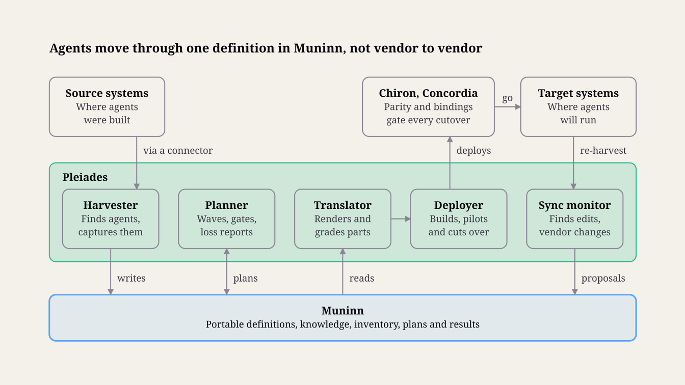
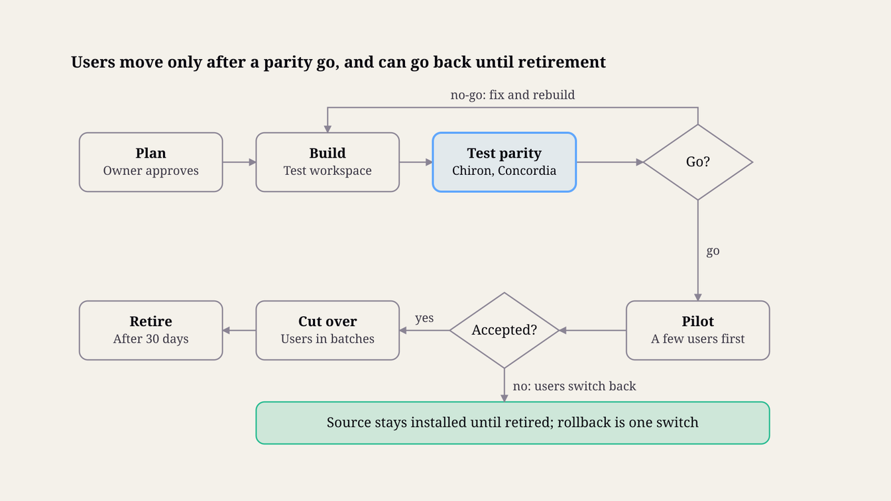

> Customer-facing page text from https://www.etmpartnersllc.com/products/pleiades (retrieved 2026-10-28).

# ETM Pleiades™: AI System Migration

## Summary and principles

Pleiades lets a company move its AI agents and agentic workflows from one AI system to another, or run them on several systems at once, without starting over. It finds what people have built and keeps one vendor-neutral definition of each agent in Muninn. It carries over what it can, rebuilds what it must and lists anything a person has to redo. Users move only after the new copy passes the original's tests.

Pleiades architecture · systems, services, Muninn and gates

### What Pleiades does

Harvests. It finds the agents, assistants, skills and workflows people have built across the company's AI systems, records who owns and uses each one, and captures their definitions.

Keeps one portable definition. Each agent becomes a vendor-neutral definition in Muninn: its instructions, skills, tools, model needs, workflow steps and the knowledge it relies on.

Migrates with proof. It translates the definition for the target system, lists anything that cannot carry over, runs Chiron's parity tests, and moves users only after the owner accepts the result.

Keeps several systems in step. When a company adds a system instead of replacing one, the same agent runs on each, and Pleiades keeps every copy in step with the approved definition, showing any copy that lags behind.

For PE operating partners, Pleiades shows how many of each portfolio company's agents are inventoried, owned and portable. A vendor change or a portfolio-wide platform choice can then be planned with known effort, and each company shares aggregate figures only.

### Design principles

One definition, many deployments. The definition in Muninn is the source, and each system's copy is generated from it, the way Muninn generates the instruction files AI tools read from its ledger.

Knowledge stays in Muninn. Pleiades moves agents and reconnects them to company knowledge; it does not copy that knowledge from one vendor into another.

Nothing is lost silently. Every migration plan lists, part by part, what carries over intact, what is translated, what is rebuilt and what someone must redo by hand.

Prove it before people move. A migrated agent must pass the original's tests before any user is cut over, and the original stays installed, ready for rollback, until the hold period after cutover ends.

Credentials never travel. Connections are re-authorized in the target under the company's identity rules, and no credential is carried into a target. A secret found in harvested text moves to the client's vault and is flagged for rotation.

Harvesting is consented and visible. People can see what was harvested from their accounts, and personal agents and memory move only with their creator's consent or under a policy the company has published.

Shared standards first. Pleiades uses formats AI systems already share, such as AGENTS.md, Agent Skills and MCP, and adds its own only where none exists.

Built on Muninn. Definitions, inventories, plans and results are Muninn records, so they inherit its security, history, entitlements and portability.

## Architecture

Pleiades is a set of services on top of Muninn, plus a connector for each AI system it reads from or writes to. Muninn holds the portable definitions, the inventory and every migration record; Pleiades harvests, translates, deploys and keeps deployments in step.

A migration starts from the inventory. Connectors read each source system, the harvester writes what it finds into Muninn, and the owner chooses what moves. The translator renders each definition for the target, the deployer installs it in a test workspace there, Chiron runs parity tests, and users move only after the owner accepts. Pleiades changes a live system only through that system's own admin interfaces, under an approved plan.

Harvest writes each agent's definition to Muninn once. The translator and deployer build every system's copy from it. Chiron's parity tests, and Concordia's checks where the client runs Concordia, must pass before users move.

### Services

| Service | Responsibility |
| --- | --- |
| Connectors | Read definitions from a system and write deployments to it, through the interfaces its vendor offers |
| Harvester | Discovers, triages, captures and normalizes agents into portable definitions (see Harvest) |
| Translator | Renders a definition for a target system and grades how faithfully each part carries over (see Translation and fidelity) |
| Planner | Builds migration plans, waves and loss reports, and tracks each gate (see The migration process) |
| Deployer | Installs definitions in test and live workspaces, moves users and triggers, and rolls back (see The migration process) |
| Sync monitor | Re-harvests live deployments, detects edits made inside a system and tracks vendor changes (see Running several AI systems at once and Systems covered) |

### Interfaces

Workspace for owners and admins: the inventory, migration plans, loss reports, test results and cutover controls, with notifications to Slack, Teams and email.

Pull requests for systems configured through repository files: changes to instruction files, skills and agent definitions arrive as pull requests, so code review and Chiron's pipeline gate apply.

MCP tools for agents: pleiades.inventory, pleiades.plan, pleiades.deploy, pleiades.diff and pleiades.status (see The migration process).

Connector kit for clients and partners who add systems, each connector with its own conformance tests (see Systems covered).

### Deployment

Pleiades deploys next to the client's Muninn, in the client's cloud or hosted by ETM. Connectors run in the client's environment and authenticate with admin credentials kept in the client's vault. In a client-hosted deployment, captured definitions never leave the client's environment; in an ETM-hosted one, they are stored only in the client's own Muninn tenant, encrypted under the client's tenant key. Model calls, such as checking a rewritten instruction for drift in meaning, go through the same model port as Concordia, Huginn and Chiron.

## What Pleiades moves

Pleiades moves an agent as a set of parts, each stored in Muninn under a built-in type, so each part can be translated, tested and owned on its own. Together the parts form the agent's portable definition, a collection versioned as one unit.

### The parts of an agent

| Part | What it holds | Examples in source systems | Muninn type |
| --- | --- | --- | --- |
| Identity | Name, purpose, owner, human sponsor and roles | A GPT's name and description; a subagent's frontmatter | AI-AGENT |
| Instructions | System prompt, standing rules and tone | GPT or project instructions; AGENTS.md and CLAUDE.md; Copilot Studio instructions | AGENT-GUIDANCE, PROMPT-TEMPLATE |
| Skills | Procedures with their scripts, templates and references | Agent Skills folders; slash commands; topics | SKILL |
| Knowledge | Files, memories and data sources the agent relies on | Knowledge files; project files; assistant memory; connected drives | Ordinary Muninn records and Reference records |
| Tools | What the agent can call, and the scopes it needs | MCP servers; GPT actions; connectors; flows | AGENT-TOOL, with credentials as vault references |
| Model needs | Reasoning depth, context size, vision, and latency and cost limits | A model picker; a model setting | AI-MODEL requirement, mapped per target |
| Workflow | Steps, branches, handoffs, approvals, triggers and schedules | Visual workflow builders; chains of subagents; scheduled runs | AGENTIC-WORKFLOW |
| Guardrails | Tool permissions, approval steps, hooks, decision rights and bound intent | Permission modes; hooks; Concordia guardrails | POLICY, ROLE, DECISION-RIGHT |
| Tests | Cases that define acceptable behavior, with baselines | Chiron suites; owner examples; past runs where policy allows | TEST-SUITE, EVAL-RUN |
| Audience | Who uses the agent, who may edit it and where it is published | Sharing settings; channels | ROLE-ASSIGNMENT and the record audience |

Instructions and guardrails change how agents behave, so Muninn treats them as Normative records, which their owners review before any deployment. Skills keep the Agent Skills folder layout, which Claude, ChatGPT and Codex, GitHub Copilot, Cursor, Gemini CLI and many other systems read, so most skills move unchanged.

### Knowledge moves through Muninn

Knowledge comes along with the agent, but it travels through Muninn rather than from one vendor to another. Harvest sends an agent's files and memories through Muninn's staged import, with its screening and sampling QA (see ETM Muninn). The new deployment then reaches that knowledge through Muninn's MCP server or the instruction files Muninn generates for each tool.

Knowledge is therefore moved once, into a store the company owns, and serves every system after that. Vendors now offer one-way memory imports, such as Claude's import from ChatGPT, Gemini and Copilot; Pleiades routes memory through Muninn instead, so the company keeps it whichever assistant people use next.

Where a target cannot reach Muninn at all, the deployer packs a snapshot of the knowledge into the target as files, stamped with its as-of date, and the sync monitor refreshes it.

### What does not move

Credentials. No credential is carried into a target; each connection is re-authorized there. Letta's Agent File, for example, sets secrets to null on export.

Conversation history held by the vendor. Chats are not moved into the target. Where policy allows, the owner can archive them in Muninn as episodes, kept for 13 months and then only where other records cite them. Past runs can also seed tests once Chiron has scrubbed them.

Work in flight. Running tasks finish or are handed off before cutover. Working memory, which Muninn keeps for hours to weeks, is not migrated.

Custom models hosted by a vendor. A fine-tuned model stays with its vendor; the loss report names it and the decision it needs.

### Open formats Pleiades reads and writes

| Format | Steward | Used for |
| --- | --- | --- |
| Agent Skills | Open standard, originally developed by Anthropic | Skills |
| AGENTS.md | Agentic AI Foundation, under the Linux Foundation | Repository instructions for coding agents |
| MCP | Agentic AI Foundation | Tools, and agents' access to Muninn |
| A2A Agent Card | Agentic AI Foundation | Agents called remotely through A2A (Agent2Agent), an open protocol for one agent to call another (see Running several AI systems at once) |
| Agent File (.af) | Letta | Stateful agents with their memory |
| Open Agent Specification | Open project introduced by Oracle | Agents and workflows built on agent frameworks |

### Relations Pleiades adds

Pleiades reuses Muninn's core relations (derivedFrom, partOf, references, supersedes) and adds a pla: extension:

| Relation | From and to |
| --- | --- |
| pla:deployedAs | Portable definition to its deployment in one system, with version and status |
| pla:harvestedFrom | Record to the source object it was captured from, with capture time and content hash |
| pla:dependsOn | Agent to the tools, skills, knowledge and other agents it needs |
| pla:usedBy | Deployment to the people and groups who use it |
| pla:mapsTo | A source feature to its equivalent in a target, with fidelity (see Translation and fidelity) |

A new deployment supersedes the one it replaced at cutover, through Muninn's core relation. Deployments and migrations also need two new built-in types, AGENT-DEPLOYMENT and MIGRATION (see Working with the other ETM sponsored projects).

## Harvest

Harvest turns what people have built inside the company's AI systems into an owned inventory and a set of portable definitions. It runs in six steps and never changes a source system: capture is read-only, and nothing is deployed anywhere until an owner has reviewed what was found.

### Steps

Connect. An admin authorizes a read-only connector for each source: an admin or compliance interface, repository access or an export file. Pleiades uses only the access the vendor's terms allow for this purpose.

Discover. The connector lists agents, assistants, skills, instruction files, projects, workflows and tool connections, with owner, creation date, sharing, users and last use. Where a client already runs an agent registry, Pleiades reads it instead of rebuilding it. Microsoft's Agent 365, for example, records each agent's owner, creation platform, publishing surface, lifecycle state and intended users (Redmond). ChatGPT's Compliance API exposes GPT configurations (OpenAI) and every workspace agent's configuration, updates and runs (OpenAI).

Triage. Pleiades groups near-duplicates, such as twenty personal versions of the same proposal writer, flags unused, ownerless and risky items, and proposes a decision for each (below). The owner decides, or the sponsor for items with no owner.

Capture. For each item kept, the connector exports the full definition and its files, records a content hash and capture time, and leaves the source untouched.

Normalize. The definition is split into the parts listed in What Pleiades moves. Instructions and files pass Muninn's ingest screening: secrets become vault references, personal data is tagged and injected instructions are quarantined. Knowledge is staged on its own branch, as in Muninn's initial population.

Review. The owner reviews instructions, guardrails and skills, with their scripts, in full. The rest is sampled under Muninn's import QA rule, and the owner then approves the portable definition as version 1.

### Triage decisions

| Decision | When it fits | What happens |
| --- | --- | --- |
| Migrate | Used, owned, and the target can run it | Translated and deployed in the target (see Translation and fidelity and The migration process) |
| Merge | Several versions of the same agent | The best version becomes the company definition, and the other versions' users move to it |
| Bridge | Valuable but costly to rebuild in the target | It stays where it runs, and other systems call it remotely (see Running several AI systems at once) |
| Keep | Stays in its current system for now | Recorded in the inventory and kept in step by sync (see Running several AI systems at once) |
| Retire | Unused, duplicated or unsafe | Archived in Muninn and switched off once its owner agrees |

### Across users

Pleiades works across users as well as systems. Harvest moves agents between people in three ways:

From one person to the company. A useful personal agent becomes a company agent. It gets an accountable owner, plus the human sponsor, role and decision rights Concordia requires of every agent. Its instructions pass owner review, and its creator stays on record as its author.

From the company to many people. An approved agent is deployed to a team, a group or the whole company, in whichever system each person works in, from the same definition.

When people leave or change roles. Company agents a person owns are reassigned to their manager or a named successor. When a person leaves, their personal agents follow Muninn's rule for personal namespaces: for 90 days, business-relevant items can be proposed to the manager, and then the rest is erased. A person who changes roles keeps their personal agents.

Personal agents and memory are harvested only with their creator's consent or under a published company policy (see Trust, safety and governance). Personal memory stays in the person's private Muninn namespace unless they choose to share it.

## Translation and fidelity

Translation renders a portable definition in a target system's own formats, part by part, and grades how faithfully each part carries over. The grades become the loss report in every migration plan, so the owner sees what will and will not behave the same before any user moves.

### Fidelity levels

| Level | Meaning | Typical examples |
| --- | --- | --- |
| Native | The part moves in a shared format and runs unchanged | A skill between two systems that read Agent Skills; AGENTS.md between coding agents; a remote MCP server |
| Translated | The target has an equivalent feature, and Pleiades rewrites the part in its format | GPT instructions into a Claude Project; path-scoped editor rules into another harness's instruction files |
| Emulated | The target has no equivalent, so Pleiades rebuilds the behavior from other parts | A GPT action wrapped as an MCP server; a schedule recreated with an external trigger |
| Manual | A person must redo it in the target | Choosing a replacement for a vendor-only built-in tool; redesigning a custom card or form |
| Not portable | Cannot move; the reason is recorded | Chat history held by the vendor; a fine-tuned model hosted by its vendor |

### Crosswalks

Each pair of systems has a crosswalk per part: a versioned mapping with the rules that implement it and the fidelity it reaches. Crosswalks are data maintained by ETM and tested by conformance suites, as Muninn's memory crosswalks are. When a vendor changes a format, the crosswalk changes; the definitions do not.

### The hard parts

Instructions. A target may expect a different structure, such as XML-tagged blocks or Markdown (Muninn's delivery profiles), and vendor-specific names of tools and features must be replaced. Pleiades rewrites rather than copies, a model checks the rewrite for drift in meaning, and the owner approves it.

Tools. Each system connects to the outside world differently, so Pleiades maps every tool to MCP where it can. A remote MCP server moves as it is. An action described by an OpenAPI schema is wrapped as an MCP server. A vendor connector is matched to the target's equivalent, or to an MCP server for the same service. Every connection is then re-authorized in the target with the narrowest scopes the agent needs.

Models. The definition states what the agent needs from a model, not a model name. Each target's crosswalk maps those needs to the models the client has approved there, and the parity tests show whether the mapped model holds up.

Workflows. Step graphs differ most between systems. Pleiades maps steps, branches, approvals and triggers one by one, and a step with no counterpart is emulated or marked manual. Even a vendor's own export carries this risk: OpenAI's guide to exporting Agent Builder workflows as code warns that the process "does not convert your workflow graph or guarantee that every behavior transfers unchanged" (OpenAI).

The commonest loss is hidden behavior: an agent can depend on defaults its old system applied without anyone writing them down. That is why parity tests, not a reading of the translation, decide when a migration is done (see The migration process).

### The loss report

Every plan carries a loss report: each part, its fidelity, the rule used, the reason for any loss and the action it needs. An illustrative report for a proposal-writing GPT moving to a Claude Project:

| Part | Fidelity | Action |
| --- | --- | --- |
| Identity | Translated | Sponsor, role and decision rights confirmed |
| Instructions | Translated | Owner approves the rewrite |
| Knowledge: price list and case studies | Native, through Muninn | Staged import; the agent reads them through Muninn's MCP server |
| Tools: CRM lookup action | Emulated | Wrapped as an MCP server and re-authorized with read-only scopes |
| Tools: image generation | Manual | Owner decides whether the agent still needs it |
| Model needs | Translated | Mapped to an approved model and confirmed by parity tests |
| Audience: the sales group | Translated | Shared with the same group in the target |

Overall fidelity is the share of an agent's parts, among those meant to move, that carry over at Native or Translated: here 5 of 7, or 71%. Past conversations stay behind by design and are not counted. A low score does not block a migration; it tells the owner where the tests and the pilot must look hardest.

## The migration process

Every migration follows the same path: plan, build in the target, test for parity, pilot with a few users, cut over, then retire the source. The source stays installed until it is retired, 30 days after cutover by default, so going back is one switch away until then.

Migration flow · 6 steps, 2 decisions, a rebuild loop and a rollback

A no-go sends the agent back to be rebuilt. Until the source is retired, a rejected pilot or a problem after cutover sends users back to it, because it stays installed until then.

### Steps

Plan. Pleiades groups the selected agents into waves by dependency and risk: shared tools and skills first, then the agents that use them. Each agent gets a plan with its loss report, the tests it must pass, the users who will move and its rollback route. Most harvested agents have no tests, so the plan also builds a starter suite from the owner's examples and, where policy allows, from past runs Chiron has scrubbed. The owner approves the plan.

Build. The deployer installs the translated definition in a test workspace of the target and connects tools with test credentials. Both copies use the same data: Muninn's test tenant, the synthetic copy of the company that Chiron uses, or else an owner-approved read-only staging connection. Where a target has no test workspace, the build is visible only to the owner and testers.

Test for parity. Chiron runs the agent's suites on the source and the target with the same cases. For an assistant with no API, such as a custom GPT, the source side uses Chiron's chat endpoint adapter where the vendor's terms allow it, or else past runs. Where the client runs Concordia, it checks that the new deployment carries the same roles, rights and intent bindings and passes the same alignment tests. A no-go returns the plan to step 2 with the failures attached.

Pilot. A small group uses the new deployment for real work while the source stays available, and Pleiades compares outcomes, usage and complaints. An agent that acts on its own, such as a scheduled workflow, first runs in shadow: it gets the same inputs as the source, and its outputs are compared but not acted on.

Cut over. The remaining users move in batches. Each trigger and schedule is switched off in the source before it is switched on in the target, so no job runs twice. The source definition is frozen so nobody edits the old copy.

Retire. After a hold period of 30 days, the source deployment is switched off and archived in Muninn. Its tests and history stay with the portable definition. The hold period must end before the source contract does.

Until retirement, rollback moves users back and switches the source's triggers on again. After retirement, a rollback is a new migration from the portable definition.

### Effort and time

How long a migration takes depends on what moves and how much of it must be translated rather than carried over natively.

| What moves | Usual fidelity | Effort per item | Where the time goes |
| --- | --- | --- | --- |
| Skills and instruction files between coding harnesses | Native or Translated | Minutes, plus about an hour of review per repository | Owner review |
| An assistant with instructions and files but no tools | Translated | About half a day, tests included | Rewriting instructions; building a starter test suite |
| An agent with tools and connections | Translated, with tools often Emulated | 1 to 3 days | Mapping and re-authorizing tools; tests |
| A multi-step workflow with triggers and approvals | Partly Emulated | 1 to 2 weeks | Rebuilding steps; shadow runs |
| Guided capture, where a system has no export | Any | About an hour more per agent | Recording settings with the owner |

A whole-system switch at a company with 100 to 500 knowledge workers is planned at 6 to 12 weeks elapsed, in waves. That assumes triage leaves a few dozen agents and a handful of complex workflows; the inventory sets the real figure. Most of the time goes to review and testing rather than translation. Harvest also shrinks the job, because merged duplicates and retired agents never need migrating.

### MCP tools

| Tool | Purpose |
| --- | --- |
| pleiades.inventory | Lists the agents, workflows and skills found in a system, with owners, users and status |
| pleiades.plan | Builds a migration plan and loss report for an agent and a target |
| pleiades.deploy | Installs a definition version in a target's test workspace. For production, it prepares the change for the admin, or applies it where direct writes are on, after the owner's step-up approval |
| pleiades.diff | Compares a live deployment with its definition and reports drift |
| pleiades.status | Returns a migration's stage, test results and next gate |

## Running several AI systems at once

Adding a system needs as much care as switching: a company keeps its coding tools and adds an assistant, or runs two assistants side by side. Pleiades treats each system's copy of an agent as a deployment of one definition and keeps every copy in step with it.

### One definition, several deployments

Each deployment records the definition version it runs, its system, its audience and its fidelity. An approved change to the definition is rendered for every deployment, tested wherever its suites run, and rolled out one system at a time.

A deployment can stay on an older version when its system cannot yet support a new part. The inventory shows the gap, and Concordia's C19 check flags any two systems acting on different versions of the same intent.

### Edits made inside a system

People will still edit an agent where they use it. The sync monitor re-harvests each deployment on a schedule, and on change events where the vendor offers them, and compares it with the version deployed. A difference becomes a proposal to the owner, just as Muninn turns edits inside its managed file sections into proposals.

An accepted edit becomes a new definition version and reaches the other systems. A rejected one is reverted the same way as any change: through a pull request, or a change prepared for the admin.

### Bridging instead of copying

Some agents are better run in one place and called from everywhere else, such as an agent with heavy integrations in one platform. Pleiades then publishes the agent's A2A Agent Card or MCP endpoint to the other systems, so one deployment serves them all. A2A reached version 1.0 in March 2026 and moved into the Agentic AI Foundation in August 2026, alongside MCP and AGENTS.md (AAIF).

A bridged agent still has one definition and one owner, and each call carries the caller's identity through Muninn's delegation chain, so entitlements hold.

### People who move between systems

Bringing agents, workflows and knowledge along applies to people too. Someone who moves from one tool to another keeps the agents assigned to them, redeployed in the new tool from the same definitions. Their personal memory follows through their Muninn namespace.

## Systems covered

Pleiades reaches each AI system through a connector, chosen by how the system stores agents: as files in a repository, as objects behind an admin interface, as code, or as workflow exports. Coverage grows one connector at a time.

| System family | Examples | How Pleiades reads and writes | Typical fidelity |
| --- | --- | --- | --- |
| Coding harnesses | Claude Code, Codex, Cursor, Gemini CLI, GitHub Copilot | Repository files through pull requests: AGENTS.md and each harness's own instruction files, Agent Skills folders, subagent definitions such as Claude Code's .claude/agents/ files (Claude Code), MCP settings and hooks | Native for skills, and for AGENTS.md except in Claude Code, which imports it from CLAUDE.md; Translated for the rest |
| Work assistants | ChatGPT GPTs, projects and workspace agents; Claude projects, skills and plugins; Microsoft 365 Copilot and Copilot Studio agents; Gemini Gems and Gemini Enterprise agents | Admin and compliance interfaces where offered; solution exports for Copilot Studio; guided capture with the owner where no export exists. Writes go through admin provisioning, such as Claude admins deploying skills to the whole organization (Anthropic) | Translated, with tools often Emulated |
| Agent frameworks | OpenAI Agents SDK, Claude Agent SDK, LangGraph, CrewAI, Google ADK | Code and declarative configuration in the repository, and Open Agent Specification where a framework supports it. Changes arrive as pull requests, rewritten with a coding agent's help and gated by tests | Translated |
| Workflow platforms | n8n, Zapier, Make, Power Automate | Workflow exports and the AI steps inside them | Partly Emulated |
| Assistant memory | ChatGPT, Claude and Gemini memory; Mem0; Letta | Through Muninn's importers and crosswalks, never from vendor to vendor; Muninn adds importers for the three assistants | Translated; each crosswalk also declares its Muninn conformance level, L0 to L3 |

Even a move within one vendor needs rework. A Copilot Studio agent exported as a solution must have its user authentication configured again after import, and its icon and channel details may be missing (Microsoft).

### Guided capture

Some systems offer no way to export an agent. For those, Pleiades walks the owner through the system's settings, records each field into the portable definition, and relies on parity tests to show whether anything was missed. Guided capture is slower, so the inventory marks which agents need it.

### The connector contract

Each connector declares a capability manifest: which parts it can read and write, at what fidelity, and through which vendor interface. It ships with conformance tests that run nightly against a test account in the vendor's system, so a vendor change is caught before a client migration depends on it. Clients and partners can write their own connectors to the same contract.

### Which systems first

The first connectors follow the order of Muninn's delivery profiles (see ETM Muninn): Claude Code and the Claude apps, then Codex and Cursor, then Gemini CLI and GitHub Copilot for repository files. For work assistants, the order is ChatGPT and Claude in both directions first, then Microsoft 365 Copilot.

### Systems that change underneath you

Vendors retire features and interfaces on their own schedules. OpenAI set August 26, 2026 as the shutdown date for its Assistants API when it announced the deprecation a year earlier (OpenAI). It also calls ChatGPT's workspace agents "an evolution of GPTs"; GPTs remain available for now, and OpenAI says it will make converting them easy (OpenAI).

Pleiades tracks deprecation notices for every system in the inventory, marks the deployments they affect, and proposes a migration plan well before the date. For systems that change behavior without notice, Chiron's canary suites catch the change.

## Trust, safety and governance

Pleiades reads every AI system a company runs and copies what people have built, so its safeguards protect credentials, people's work and the systems it writes to.

### Credentials

Connectors hold only the admin credentials a client grants, kept in the client's vault and limited to reading during harvest. No credential is carried into a target. A secret found inside instructions or files moves to the client's vault at harvest and is flagged for rotation, and each migrated connection is re-authorized in the target with the narrowest scopes the agent needs.

### People's work and privacy

A published harvest policy sets what may be harvested, from whom and why, and discovery itself runs under it. Personal agents and memory need their creator's consent unless the policy says otherwise and local law allows it.

People can see what was harvested from their accounts and can object, and creators stay on record as authors.

Pleiades reports on agents, not people. It records who uses each agent only to move them and to measure adoption in aggregate, and produces no per-person scores or rankings, as in Concordia.

Employment and monitoring rules differ by country, so the client's counsel reviews the harvest policy, and works councils are consulted where they exist.

### Harvested instructions are untrusted until reviewed

Instructions written by many people can carry unsafe directives or injected text. They pass Muninn's injection screening, and Concordia's principle-conflict check (C16) where the client runs Concordia, before any deployment. Owners review them in full.

### Entitlements travel with the agent

A deployment may reach a wider audience than its source did. Knowledge therefore stays in Muninn wherever the target can reach it, and each user sees only what they may see. A snapshot packed into a target holds only records that everyone who can read it there may read, including the agent's users, its editors and the platform's admins. That is the rule Muninn applies to its file projections.

### Changes to live systems

Pleiades writes to a live system only through the vendor's admin interfaces or a reviewed pull request, under a plan the owner approved, with a rollback route. By default it prepares changes for the client's admin to apply; direct writes are switched on system by system. Every change goes to the Muninn audit log.

### Vendor terms and data location

Connectors use only the interfaces a vendor's terms allow for the purpose, and the vendor's own export paths first. Captured definitions stay in the client's Muninn tenant, and a target in another region is flagged to the data's owner before anything moves.

### Switching rights

For EU customers, the Data Act has applied since 12 September 2025 to SaaS and other data processing services. Contracts must specify the data and digital assets that can be ported. The transitional period in which providers may charge switching fees ends on 12 January 2027 (Hogan Lovells Cadwalader). The customer's notice period may not exceed two months. The switch must then complete within 30 calendar days, extendable by up to seven months where that is technically unfeasible (McCann FitzGerald).

Whether agent definitions count as portable assets under a given contract is a question for counsel, and a large switch should be planned before notice is given.

### Reproducibility and audit

Every migration pins the definition version, the connector and crosswalk versions and the test results, so it can be audited and repeated. Inventories, plans, loss reports, verdicts and cutovers are all Muninn records.

## Working with the other ETM sponsored projects

Pleiades depends on Muninn and trades work with the other four projects. Every exchange goes through Muninn records.

| Project | What Pleiades uses | What Pleiades provides |
| --- | --- | --- |
| Muninn | Records for definitions, inventories and plans; staged import and sampling QA for harvested knowledge; delivery through MCP and file projections; the vault; the audit log | Harvested knowledge and agent definitions, and deployment records that tell Muninn which systems to serve |
| Concordia | Each agent's sponsor, roles, decision rights and bound intent; checks C16, C19 and C20 | Migration of agents with their bindings intact, and an inventory of every agent in every system for Concordia's agent checks |
| Chiron | Parity suites and verdicts that gate every cutover; canary suites for systems that change without notice | Migration events that trigger parity runs, and good past runs harvested as golden cases |
| Huginn | Thought processes packaged as portable skills; deliberation on hard migration choices, such as which system to standardize on or whether to bridge or rebuild an agent | Movement of Huginn's deliberation workflows and toolkits between systems |
| Delos | Analysis of what drives adoption and outcomes after a switch | Usage and outcome data from before and after each migration |

## Talk to ETM

See how ETM Pleiades fits your company. [Schedule a Discussion](https://calendly.com/joe-etmpartners/30min) or write to joe@etmpartnersllc.com.

## Sources

Agent Skills overview, agentskills.io

AGENTS.md, Agentic AI Foundation

A2A v1.0: a builder's guide, part 1, Agentic AI Foundation, August 27, 2026

Agent File (.af), Letta documentation

Introducing Open Agent Specification, Oracle, October 7, 2025

Skills for organizations, partners, the ecosystem, Anthropic, December 18, 2025

Create custom subagents, Claude Code documentation

Claude can now import chat histories from ChatGPT (and other AIs), PCWorld, March 3, 2026

New compliance and administrative tools for ChatGPT Enterprise, OpenAI, July 18, 2024, updated December 11, 2025

Introducing workspace agents in ChatGPT, OpenAI, April 22, 2026

Assistants API beta deprecation, August 26, 2026 sunset, OpenAI developer forum announcement, August 26, 2025

Migrate from Agent Builder, OpenAI developer documentation

Export and import agents using solutions, Microsoft Learn

Microsoft details how it is using Agent 365 to rein in AI agent sprawl, Redmond Magazine, August 10, 2026

EU Data Act series, part 7: easy switching between data processing services, Hogan Lovells Cadwalader

EU Data Act: switching cloud provider, McCann FitzGerald, September 17, 2025